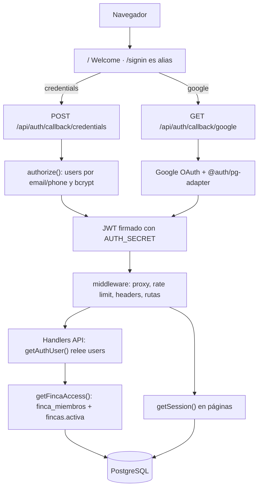
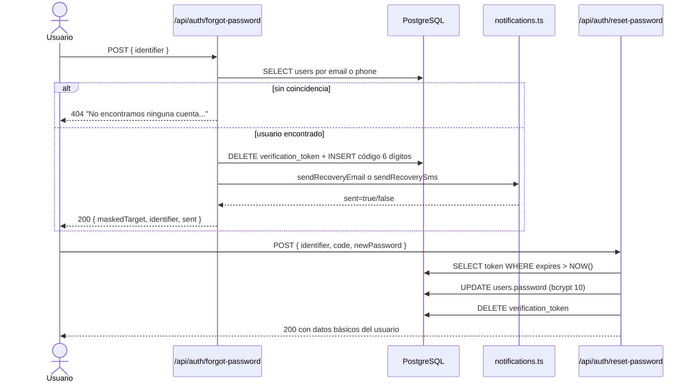
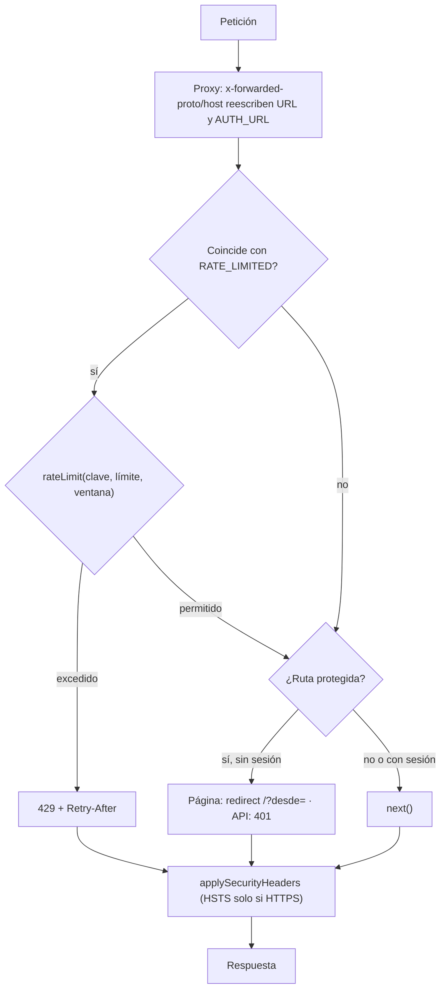

# Autenticación y Autorización — Macollo

> Verificado contra el código el 2026-11-23. Documento rector: docs/README.md. Parte de la documentación unificada (docs/UNIFIED/MACOLLO-DOCUMENTACION-UNIFICADA.md). Identificador: **DOC-13**.

Este documento describe el comportamiento **implementado** de autenticación (quién es el usuario) y autorización (qué puede hacer), con referencias de código verificables. La referencia operativa de bodies y códigos de respuesta es [ENDPOINTS](./ENDPOINTS.md); la política de secretos y amenazas es [SECURITY](./SECURITY.md). Cuando otra documentación difiera de lo aquí indicado, prevalece el código citado.

## 1. Fuentes de verdad y modelo de confianza

| Componente                | Archivo                                                           | Responsabilidad                                              |
| :------------------------ | :---------------------------------------------------------------- | :----------------------------------------------------------- |
| Configuración Auth.js     | `auth.config.ts`                                                  | Proveedores, estrategia JWT, secret, callbacks               |
| Filtrado de peticiones    | `src/middleware.ts`                                               | Cabeceras, límite de tasa, protección gruesa de rutas, proxy |
| Servicios de autorización | `src/backend/services/authz.ts`                                   | Relectura de rol, helpers de permisos, cookie de finca       |
| Servicios de fincas       | `src/backend/services/farms.ts`                                   | Membresías, invitaciones, resolución de finca activa         |
| Endpoints de auth         | `src/pages/api/auth/*.ts`                                         | Registro, disponibilidad, recuperación                       |
| Endpoints administrativos | `src/pages/api/admin/users/*.ts`                                  | Gestión de usuarios y roles                                  |
| Esquema                   | `src/db/auth-schema.sql`, `src/db/migrations/001-roles-farms.sql` | ENUM de roles, tablas y restricciones                        |

Existen dos planos de identidad que no deben confundirse:

1. **Sesión JWT (Auth.js).** `session.strategy = "jwt"` (`auth.config.ts:170-174`). El token contiene `sub`, `role` y `sessionStartedAt` (`auth.config.ts:187-207`) y se entrega en una cookie gestionada por Auth.js.
2. **Identidad autoritativa en PostgreSQL.** `getAuthUser()` lee `id, role, name, email, image` de `users` en cada handler sensible (`src/backend/services/authz.ts:50-73`). Un cambio de rol o la eliminación del usuario surte efecto en cuanto se reconsulta la BD, aunque el JWT siga vigente.

> El rol del JWT **no** se usa como fuente de verdad para autorizar operaciones de datos. Se usa para representación en páginas y como apoyo al middleware; las decisiones de permiso se toman con el rol leído de la BD.

## 2. Arquitectura del flujo



La página de entrada es `/` (`auth.config.ts:176-178`). El archivo `src/pages/signin.astro:1-25` conserva `/signin` únicamente como alias: si no hay sesión redirige a `/` propagando `?desde=` y `?code=`; si hay sesión, redirige al destino indicado por `desde` o a `/`. El middleware, cuando detecta una página protegida sin sesión, redirige a `/?desde=<ruta>` (`src/middleware.ts:148-157`).

El despliegue es SSR (`output: "server"`) con adaptador de Vercel y `maxDuration: 60` (`astro.config.mjs:12-20`). El middleware reescribe la URL y `process.env.AUTH_URL` a partir de `x-forwarded-proto` y `x-forwarded-host` para operar detrás de proxy o túnel (`src/middleware.ts:76-96`).

## 3. Proveedores y sesión

### 3.1. Credenciales

`authorize()` (`auth.config.ts:75-167`) sigue este orden:

| Paso                    | Comportamiento                                                                                                            | Referencia                                          |
| :---------------------- | :------------------------------------------------------------------------------------------------------------------------ | :-------------------------------------------------- |
| Normalización           | `trim()` del identificador; se acepta `email` o el alias `username`; se exige contraseña                                  | `auth.config.ts:76-87`                              |
| Búsqueda                | `LOWER(COALESCE(email,'')) = LOWER($1) OR phone = $1`, con `ORDER BY CASE` para priorizar coincidencia por email          | `auth.config.ts:93-103`                             |
| Verificación bcrypt     | Solo hashes que cumplen `/^\$2[aby]\$/` se comparan con `bcrypt.compare`                                                  | `auth.config.ts:115-116`                            |
| Compatibilidad heredada | Si el valor almacenado no es un hash y es **igual** a la contraseña enviada, se acepta una vez y se programa su migración | `auth.config.ts:117-122`                            |
| Migración               | `bcrypt.hash(password, 10)` + `UPDATE users SET password, updated_at`                                                     | `auth.config.ts:127-144`                            |
| Emisión                 | `{ id, name, email, image, role }`; si no hay email se sintetiza `<phone                                                  | id>@invernadero.local`; rol por defecto `Campesino` | `auth.config.ts:148-158` |

Un identificador inexistente, una contraseña inválida o un error de BD producen `null`; Auth.js lo traduce al error `CredentialsSignin` (`auth.config.ts:106-108`, `161-166`). No hay bloqueo ni contador de intentos fallidos por cuenta en el código de `authorize`; el único freno es el límite de tasa por IP del middleware (sección 7).

El uso de contraseñas en texto plano como mecanismo de compatibilidad es una brecha deliberada y temporal: cualquier fila de `users` con `password` que no empiece por `$2a$`, `$2b$` o `$2y$` se acepta si coincide literalmente. La migración se registró en logs (`auth.config.ts:135-137`) y debe verificarse con SQL (sección 8).

### 3.2. Google OAuth

El proveedor Google se configura con `GOOGLE_CLIENT_ID` y `GOOGLE_CLIENT_SECRET` (`auth.config.ts:58-68`, `.env.example:20-21`) y declara `allowDangerousEmailAccountLinking: true`. En consecuencia, una identidad Google con un email que ya existe en `users` puede vincularse a esa cuenta sin un paso adicional de verificación de propiedad en la aplicación. Las cuentas OAuth se persisten en `accounts` a través de `@auth/pg-adapter` (`auth.config.ts:56`, `src/db/auth-schema.sql:46-60`).

### 3.3. Sesión JWT y expiración absoluta

| Parámetro      | Valor implementado                                                                              | Referencia                        |
| :------------- | :---------------------------------------------------------------------------------------------- | :-------------------------------- |
| `strategy`     | `jwt`                                                                                           | `auth.config.ts:171`              |
| `maxAge`       | `SESSION_MAX_AGE_HOURS` en horas (por defecto 24), con mínimo 1 hora y redondeo a segundos      | `auth.config.ts:39-52`, `170-173` |
| `updateAge`    | Igual a `maxAge`: no hay renovación deslizante                                                  | `auth.config.ts:173`              |
| `secret`       | `AUTH_SECRET` (obligatorio si `NODE_ENV=production`; en dev hay clave temporal con advertencia) | `auth.config.ts:28-37`, `175`     |
| `pages.signIn` | `/`                                                                                             | `auth.config.ts:176-178`          |

`callbacks.jwt` guarda `sessionStartedAt` en el primer inicio de sesión y devuelve `null` cuando `now - sessionStartedAt >= sessionMaxAge` (`auth.config.ts:187-207`). Esto complementa `exp`: Auth.js re-firma el JWT en cada lectura, por lo que el sello propio evita que la sesión se renueve indefinidamente. Para tokens emitidos antes de este mecanismo se rellena `sessionStartedAt` con la hora actual (`auth.config.ts:199-201`), es decir, se les concede una ventana completa adicional.

`callbacks.session` copia únicamente dos claims: `session.user.id = token.sub` y `session.user.role = token.role ?? "Campesino"` (`auth.config.ts:180-186`). No hay revocación server-side del JWT: un cambio de contraseña o un `signout` en otra pestaña no invalida tokens ya emitidos; la relectura de BD mitiga el efecto en las APIs, no en las etiquetas de la UI.

## 4. Registro y comprobación de disponibilidad

### 4.1. `POST /api/auth/register`

`RegisterSchema` (`src/pages/api/auth/register.ts:8-27`) y la lógica posterior aplican:

| Campo         | Regla                                                                   | Observación                                                           |
| :------------ | :---------------------------------------------------------------------- | :-------------------------------------------------------------------- |
| `name`        | `string().min(2)`, luego `trim()`                                       | Primer error Zod se devuelve en `message` (400)                       |
| `email`       | `z.email()` opcional o `""`; se normaliza a minúsculas                  | Unicidad case-insensitive comprobada en aplicación (`:96-107`)        |
| `phone`       | Opcional; se eliminan espacios, guiones y paréntesis; `/^\+?\d{7,15}$/` | Unicidad exacta comprobada en aplicación (`:109-120`)                 |
| `birthDate`   | Opcional; `YYYY-MM-DD` real y no futura                                 | `isValidBirthDate` (`:36-54`)                                         |
| `password`    | `min(8)`                                                                | Hash con `bcrypt.hash(password, 10)` (`:127`)                         |
| `accountType` | `z.enum(["Campesino","Agropecuario"])`, defecto `Campesino`             | **El cliente elige el rol**; los roles staff no son alcanzables       |
| `fincaNombre` | Opcional, `max(255)`                                                    | Obligatorio en la práctica si `accountType=Agropecuario` (`:122-125`) |

El `INSERT` devuelve `id, name, email, phone, birth_date, role` y responde `201` con `user`, `fincaCreada` y `avisoCreacion` (`:129-171`). Si la creación de la finca falla, el usuario queda creado y se devuelve un aviso; no se revierte la transacción (`:148-159`). Un campo `role` enviado por el cliente es ignorado por Zod: no figura en el esquema y se elimina al parsear.

La unicidad de email está respaldada por `UNIQUE` en la BD (`src/db/auth-schema.sql:34`); la de teléfono **no** tiene restricción equivalente (`:35`). Las comprobaciones `SELECT` previas al `INSERT` no son atómicas, por lo que existen ventanas de carrera, especialmente para `phone`.

### 4.2. `POST /api/auth/check-availability`

Endpoint público que responde `{ emailTaken, phoneTaken }` (`src/pages/api/auth/check-availability.ts:12-41`). Normaliza email a minúsculas y celular eliminando separadores, y solo consulta el teléfono si cumple `/^\+?\d{7,15}$/`. El esquema valida longitudes máximas (255 y 50), **no** formato de email. No exige sesión y no aparece en la lista de rutas con límite de tasa del middleware: es un oráculo de existencia de cuentas por diseño y debe considerarse en el análisis de enumeración (ver [SECURITY](./SECURITY.md)).

## 5. Recuperación de contraseña



| Aspecto                | Implementación                                                                                         | Referencia                         |
| :--------------------- | :----------------------------------------------------------------------------------------------------- | :--------------------------------- |
| Código                 | 6 dígitos decimales generados con `Math.random()`                                                      | `forgot-password.ts:79`            |
| Validez                | 15 minutos (`Date.now() + 15 * 60 * 1000`)                                                             | `forgot-password.ts:80`            |
| Identificador canónico | `user.email` si el input contiene `@`, en su defecto `user.phone`                                      | `forgot-password.ts:82-85`         |
| Almacenamiento         | Se borran tokens previos del mismo identificador y se inserta el nuevo en texto plano                  | `forgot-password.ts:87-94`         |
| Enmascaramiento        | Email: primeras 2 letras + hasta 5 asteriscos + dominio; teléfono: primeros 3 + asteriscos + últimos 2 | `forgot-password.ts:9-26`, `96-98` |
| Entrega                | `sendRecoveryEmail` (Nodemailer/SMTP) o `sendRecoverySms` (Twilio REST)                                | `forgot-password.ts:100-122`       |
| Verificación           | `identifier = $1 AND token = $2 AND expires > NOW()`                                                   | `reset-password.ts:34-47`          |
| Actualización          | `bcrypt.hash(newPassword, 10)`, `updated_at=NOW()`, borrado del token                                  | `reset-password.ts:49-68`          |

Consideraciones derivadas del código:

- La respuesta de `forgot-password` devuelve `identifier` **sin enmascarar** junto a `maskedTarget` (`forgot-password.ts:124-135`). El `maskedTarget` reduce la exposición en pantalla, pero el campo `identifier` conserva el valor canónico.
- Un usuario inexistente produce `404`, lo que permite distinguir cuentas existentes (`forgot-password.ts:66-74`).
- Sin `SMTP_USER`/`SMTP_PASS` (o los alias `GMAIL_USER`/`GMAIL_APP_PASSWORD`), `sendRecoveryEmail` registra el código en logs y devuelve `sent: false` (`src/backend/services/notifications.ts:27-49`); el token ya quedó guardado y sigue siendo usable. Para SMS faltan `TWILIO_ACCOUNT_SID`, `TWILIO_AUTH_TOKEN` y `TWILIO_PHONE_NUMBER`, con el mismo patrón de fallback a logs (`notifications.ts:138-157`). Estas variables Twilio **no** figuran en `.env.example`.
- El canje del código no es atómico: la consulta de validez y el borrado posterior son dos sentencias separadas (`reset-password.ts:34-47`, `66-68`). No hay contador de intentos, hash del token ni invalidación de sesiones JWT vigentes.

## 6. Modelo de autorización

### 6.1. Roles del sistema (enum exacto)

Los cuatro valores de `user_role_enum` son `Superadmin`, `Admin`, `Agropecuario` y `Campesino` (`src/db/auth-schema.sql:13-28`; migración en `src/db/migrations/001-roles-farms.sql:16-46`). El tipo TS homólogo está en `src/backend/services/authz.ts:3`, y la lista usada por el panel admin en `src/pages/api/admin/users/[id].ts:17-18`. No existen los valores `Super admin`, `Agronomo` ni variantes en minúsculas: la migración 001 los transforma (`001-roles-farms.sql:29-41`).

| Rol            | Definición operativa en código                                                                                                 |
| :------------- | :----------------------------------------------------------------------------------------------------------------------------- |
| `Superadmin`   | `canManageSystem` y `canHardDeleteFinca` devuelven `true` exclusivamente para este rol (`authz.ts:79-85`).                     |
| `Admin`        | Staff con acceso total a fincas; puede archivar, pero no gestionar usuarios ni hacer hard delete (`authz.ts:75-77`, `83-85`).  |
| `Agropecuario` | Dueño típico; puede crear fincas (hasta 5) y registrar `fincaNombre` en el registro (`farms.ts:25-26`, `register.ts:122-125`). |
| `Campesino`    | Rol por defecto; no puede crear fincas (`src/pages/api/farms/index.ts:40-44`) y se une por invitación como `miembro`.          |

### 6.2. Matriz de permisos por finca

`FincaAccess` tiene cuatro valores: `none`, `miembro`, `dueno` y `staff` (`authz.ts:6-7`). `getFincaAccess` devuelve `staff` de inmediato para Superadmin/Admin y, para el resto, consulta `finca_miembros` join `fincas` con `f.activa = TRUE` (`authz.ts:91-107`). Las reglas son `canManageFinca` (`:109-111`), `canViewFincaData` (`:113-116`), `canWriteFincaData` (`:118-121`) y `canConnectSheets` (`:123-129`).

| Identidad                      | Nivel resultante | Ver datos | Registrar mediciones | Gestionar finca/miembros/invitaciones | Archivar | Hard delete | Sheets | Gestionar usuarios |
| :----------------------------- | :--------------- | :-------: | :------------------: | :-----------------------------------: | :------: | :---------: | :----: | :----------------: |
| `Superadmin`                   | `staff`          |    Sí     |          Sí          |                  Sí                   |    Sí    |     Sí      |   Sí   |         Sí         |
| `Admin`                        | `staff`          |    Sí     |          Sí          |                  Sí                   |    Sí    |     No      |   Sí   |         No         |
| `dueno`                        | `dueno`          |    Sí     |          Sí          |                  Sí                   |    Sí    |     No      |   Sí   |         No         |
| `miembro`                      | `miembro`        |    Sí     |          Sí          |                  No                   |    No    |     No      |   Sí   |         No         |
| Sin membresía o finca inactiva | `none`           |    No     |          No          |                  No                   |    No    |     No      |   No   |         No         |

Fuentes de la matriz: `getFincaAccess` y helpers en `authz.ts:75-129`; `canHardDeleteFinca` aplicado en `src/pages/api/farms/[id].ts:94`; archivado en `farms/[id]/archive.ts:29-30`; lecturas en `farms/[id]/readings.ts:31-32`, `47-48`, `80-81`; sincronización en `src/pages/api/sync-sheets.ts:65-70`.

> **Corrección de deriva.** `canConnectSheets` devuelve `true` para `dueno`, `staff` **y** `miembro` (`authz.ts:127-129`), y el handler de `/api/sync-sheets` solo bloquea `none` (`sync-sheets.ts:65-70`). La afirmación anterior de este documento —y la de `docs/ENDPOINTS.md:162`— de que la sincronización es exclusiva del dueño es incorrecta. Registrar mediciones manualmente y conectar/sincronizar Hojas son acciones distintas con permisos distintos.

### 6.3. Gestión administrativa de usuarios

| Operación                     | Regla                                                                                                          | Referencia                                    |
| :---------------------------- | :------------------------------------------------------------------------------------------------------------- | :-------------------------------------------- |
| `GET /api/admin/users?q=`     | Solo Superadmin; filtra nombre/email/teléfono con `ILIKE`, ordena por rol y nombre, `LIMIT 200`                | `admin/users/index.ts:12-34`                  |
| `PATCH /api/admin/users/:id`  | Solo Superadmin; `role` validado contra los 4 valores del enum                                                 | `admin/users/[id].ts:17-18`, `27-67`          |
| Salvaguarda de roles          | No se puede degradar ni eliminar al último `Superadmin`                                                        | `admin/users/[id].ts:20-25`, `48-54`, `89-91` |
| `DELETE /api/admin/users/:id` | Prohíbe auto-eliminación; bloquea con `409` si el usuario es dueño de alguna finca; traduce FK `23503` a `409` | `admin/users/[id].ts:69-124`                  |

El cambio de rol se escribe en `users` y se registra en logs con el administrador responsable (`admin/users/[id].ts:56-63`). La relectura de `getAuthUser` hace que el nuevo rol se aplique de inmediato en las APIs; las páginas que solo usan `getSession` conservarán el rol del JWT hasta su expiración.

### 6.4. Fincas, invitaciones y finca activa

- `finca_miembros` es N:N con `rol_finca CHECK (rol_finca IN ('dueno','miembro'))`, `UNIQUE (finca_id, user_id)` y borrado en cascada (`001-roles-farms.sql:68-78`).
- El límite de creación es **5 fincas por usuario**, comprobado antes de insertar (`src/backend/services/farms.ts:25-26`, `87-96`).
- Los códigos de invitación tienen **8 caracteres** en mayúsculas, alfabeto `nolookalikesSafe` y reintento ante colisión (`farms.ts:28-56`). El canje valida `activa`, `finca_activa`, `expira_en` y `usos_usados < usos_maximos`, bloquea la fila con `FOR UPDATE OF i` y escribe la membresía `miembro` en una transacción (`farms.ts:304-369`). El endpoint exige sesión y aplica límite de tasa (`src/pages/api/invitations/use.ts:17-42`, `src/middleware.ts:36`).
- La cookie `finca_activa` es `HttpOnly; SameSite=Lax; Max-Age=2592000; Path=/`, con `Secure` añadido solo si `NODE_ENV=production` (`authz.ts:137-147`). Su valor no está firmado, pero `resolveActiveFinca` lo contrasta con la lista de fincas permitidas al usuario (`farms.ts:413-429`); si la cookie es inválida y el usuario tiene una sola finca, esa finca se selecciona automáticamente (`:426`).
- `CREATE TABLE fincas.dueno_id` usa `ON DELETE RESTRICT` (`001-roles-farms.sql:51-60`), coherente con el bloqueo de borrado de usuarios dueños.

### 6.5. Perfil del usuario

`PATCH /api/users/me` actualiza únicamente `name` y `image` del usuario autenticado (`src/pages/api/users/me.ts:35-60`, `src/backend/services/profile.ts:13-42`). La imagen acepta `""`, `data:image/(png|jpeg|jpg|webp);base64,…` o una URL `http(s)`, con tope de 400.000 caracteres (`users/me.ts:11-12`, `22-29`). No permite cambiar email, teléfono, contraseña ni rol.

## 7. Protección perimetral: middleware

### 7.1. Límites de tasa reales

`RATE_LIMITED` en `src/middleware.ts:30-37` define exactamente cinco reglas. La clave es `<prefijo>:<IP>`, donde la IP se obtiene del primer valor de `x-forwarded-for`, o de `x-real-ip`, o del literal `unknown` (`src/backend/services/rateLimit.ts:61-65`). La ventana es **deslizante** y el exceso responde `429` con `Retry-After` (`middleware.ts:100-127`).

| Ruta                             |        Límite |       Ventana | Clave                                 |
| :------------------------------- | ------------: | ------------: | :------------------------------------ |
| `/api/auth/register`             | 10 peticiones | 300 s (5 min) | `/api/auth/register:<IP>`             |
| `/api/auth/forgot-password`      |  8 peticiones |         300 s | `/api/auth/forgot-password:<IP>`      |
| `/api/auth/reset-password`       |  8 peticiones |         300 s | `/api/auth/reset-password:<IP>`       |
| `/api/auth/callback/credentials` | 20 peticiones |         300 s | `/api/auth/callback/credentials:<IP>` |
| `/api/invitations/use`           | 15 peticiones |         300 s | `/api/invitations/use:<IP>`           |

El contador vive en un `Map` en memoria, con limpieza perezosa cuando se superan 10.000 buckets (`rateLimit.ts:5-10`, `31-37`). No hay límite por cuenta, por identificador de recuperación ni para `check-availability`. En múltiples instancias serverless cada una mantiene su propio contador.

### 7.2. Rutas protegidas

| Tipo    | Rutas                                                                                                                         | Sin sesión               |
| :------ | :---------------------------------------------------------------------------------------------------------------------------- | :----------------------- |
| Páginas | `/metrics`, `/history`, `/settings`, `/farms`, `/gallery`, `/admin` (y subrutas)                                              | `redirect` a `/?desde=…` |
| APIs    | Prefijos `/api/farms`, `/api/invitations`, `/api/admin`, `/api/farm`, `/api/gallery`, `/api/sync-sheets`, `/api/export-excel` | `401` JSON               |

Fuente: `src/middleware.ts:9-27`, `129-159`. La comparación de páginas usa igualdad o prefijo con `/`; la de APIs usa `pathname.startsWith(p)` sin exigir frontera de segmento (`:133-135`), por lo que un prefijo como `/api/farm` también alcanza rutas que empiecen por esos caracteres. Las reglas de tasa, en cambio, sí comprueban igualdad o `prefijo + "/"` (`:102`).

### 7.3. Cabeceras exactas

`applySecurityHeaders` se aplica a respuestas `429`, `401`, redirecciones y al resultado de `next()` (`src/middleware.ts:64-74`, `122`, `145`, `156`, `161-163`).

| Cabecera                     | Valor literal                                                                                  |
| :--------------------------- | :--------------------------------------------------------------------------------------------- |
| `X-Frame-Options`            | `DENY`                                                                                         |
| `X-Content-Type-Options`     | `nosniff`                                                                                      |
| `Referrer-Policy`            | `strict-origin-when-cross-origin`                                                              |
| `Permissions-Policy`         | `camera=(self *), microphone=(), geolocation=(self), payment=()`                               |
| `Cross-Origin-Opener-Policy` | `same-origin`                                                                                  |
| `X-DNS-Prefetch-Control`     | `off`                                                                                          |
| `Strict-Transport-Security`  | `max-age=31536000; includeSubDomains` **solo** si la URL es HTTPS o `x-forwarded-proto: https` |
| `Content-Security-Policy`    | Ver bloque siguiente                                                                           |

```text
default-src 'self';
script-src 'self' 'unsafe-inline';
style-src 'self' 'unsafe-inline';
img-src 'self' data: blob: https:;
font-src 'self' data:;
connect-src 'self' https://api.open-meteo.com https://api.waqi.info;
object-src 'none';
base-uri 'self';
form-action 'self';
frame-ancestors 'none'
```

La CSP se construye con `join("; ")` (`src/middleware.ts:49-61`): no hay `upgrade-insecure-requests`, no hay directiva `worker-src` explícita y se permite `unsafe-inline` en scripts y estilos (necesario para Astro en desarrollo y para componentes inline, según el comentario del código). `connect-src` incluye Open-Meteo y WAQI porque el tablero los consulta desde el cliente (`middleware.ts:55-56`).



## 8. Procedimientos de verificación

Los comandos asumen el servidor local en `http://localhost:4321` y un shell POSIX.

```bash
BASE=http://localhost:4321

# Cabeceras de seguridad (HSTS no aparece en http plano: es esperado)
curl -sSI "$BASE/" | grep -iE '^(HTTP/|content-security-policy|x-frame-options|x-content-type-options|referrer-policy|permissions-policy|cross-origin-opener-policy|x-dns-prefetch-control|strict-transport-security):'

# Registro de un Campesino
curl -sS -o /tmp/opencode/reg.json -w '%{http_code}\n' \
  -X POST "$BASE/api/auth/register" -H 'Content-Type: application/json' \
  -d '{"name":"Prueba Audit","email":"audit-2026@example.com","password":"secreto123"}'

# Intento de escalada de rol: accountType no asigna role; role se ignora
curl -sS -X POST "$BASE/api/auth/register" -H 'Content-Type: application/json' \
  -d '{"name":"Prueba Audit","email":"audit-role@example.com","password":"secreto123","role":"Superadmin"}'

# Disponibilidad (público y sin límite de tasa)
curl -sS -X POST "$BASE/api/auth/check-availability" \
  -H 'Content-Type: application/json' -d '{"email":"audit-2026@example.com"}'

# Sin sesión: 401 en API protegida y redirección en página protegida
curl -sS -o /dev/null -w 'admin: %{http_code}\n' "$BASE/api/admin/users"
curl -sS -o /dev/null -w 'metrics: %{http_code} -> %{redirect_url}\n' "$BASE/metrics"

# Con sesión de Superadmin (sustituir por la cookie Auth.js de la sesión)
curl -sS "$BASE/api/admin/users?q=audit" -H 'Cookie: <cookie-de-sesion-authjs>'

# Perfil propio: solo name/image
curl -sS -X PATCH "$BASE/api/users/me" -H 'Content-Type: application/json' \
  -H 'Cookie: <cookie-de-sesion-authjs>' -d '{"name":"Nombre Auditado"}'

# Límite de tasa: 11 intentos sobre register con body inválido; el 11º debe ser 429
for i in $(seq 1 11); do
  curl -sS -o /dev/null -w '%{http_code} ' -X POST "$BASE/api/auth/register" \
    -H 'Content-Type: application/json' -d '{}'
done; echo

# Recuperación: sin SMTP configurado devuelve sent=false y el código queda en logs
curl -sS -X POST "$BASE/api/auth/forgot-password" \
  -H 'Content-Type: application/json' -d '{"identifier":"audit-2026@example.com"}'
```

Comprobaciones SQL útiles (`psql "$DATABASE_URL"` o Query Tool de pgAdmin):

```sql
-- ENUM exacto (debe devolver 4 filas: Superadmin, Admin, Agropecuario, Campesino)
SELECT e.enumlabel
FROM pg_enum e JOIN pg_type t ON t.oid = e.enumtypid
WHERE t.typname = 'user_role_enum'
ORDER BY e.enumsortorder;

-- Distribución de roles y cuántos Superadmin existen
SELECT role, count(*) FROM users GROUP BY role ORDER BY role;

-- Contraseñas no migradas a bcrypt (deben dar 0 tras el primer login de cada cuenta)
SELECT id, email FROM users
WHERE password IS NOT NULL AND password !~ '^\$2[aby]\$';

-- Duplicados: email está protegido por UNIQUE; phone no
SELECT lower(email) AS email, count(*) FROM users WHERE email IS NOT NULL
GROUP BY 1 HAVING count(*) > 1;
SELECT phone, count(*) FROM users WHERE phone IS NOT NULL
GROUP BY 1 HAVING count(*) > 1;

-- Códigos de recuperación vigentes (almacenados en texto plano)
SELECT identifier, token, expires FROM verification_token
WHERE expires > NOW() ORDER BY expires DESC LIMIT 10;

-- Membresías y coherencia de dueños
SELECT f.id, f.dueno_id, m.user_id, m.rol_finca, f.activa
FROM fincas f LEFT JOIN finca_miembros m ON m.finca_id = f.id
ORDER BY f.id;

-- Superadmin con más de una finca en propiedad (no se puede borrar desde /admin)
SELECT dueno_id, count(*) FROM fincas GROUP BY dueno_id HAVING count(*) > 1;
```

## 9. Amenazas mitigadas y brechas abiertas

| Amenaza                              | Mitigación implementada                                                                             |
| :----------------------------------- | :-------------------------------------------------------------------------------------------------- |
| Fuerza bruta de login                | 20 intentos / 300 s por IP en `callback/credentials` (`middleware.ts:35`)                           |
| Abuso de registro y recuperación     | 10 y 8 intentos / 300 s por IP respectivamente (`middleware.ts:32-34`)                              |
| Robo de sesión por XSS parcial       | Cookie de sesión gestionada por Auth.js y cookie `finca_activa` con `HttpOnly` (`authz.ts:140-142`) |
| Clickjacking y MIME sniffing         | `X-Frame-Options: DENY`, `nosniff`, `frame-ancestors 'none'` (`middleware.ts:40-41`, `60`)          |
| Escalada de rol desde el registro    | `accountType` restringido a dos valores; `role` ignorado (`register.ts:20`, `122`)                  |
| Cambio de rol no reflejado en la API | Relectura de `users` en `getAuthUser` (`authz.ts:50-73`)                                            |
| Datos entre fincas                   | `finca_id` en `plantas`/`lecturas` (`001-roles-farms.sql:99-134`) y verificación de membresía       |

Brechas que permanecen abiertas y su detalle en [SECURITY](./SECURITY.md): contadores de tasa en memoria y IP confiada de cabeceras proxy; códigos de recuperación generados con `Math.random()`, almacenados sin hash y sin límite de intentos; aceptación de contraseñas en texto plano; ausencia de revocación de JWT; vinculación automática de cuentas Google; oráculos de existencia en `forgot-password` y `check-availability`.

## Trazabilidad

| Tema                         | Archivo(s) de código                                                                              | Doc(s) relacionado(s)                                            | Verificación sugerida                                                                                |
| :--------------------------- | :------------------------------------------------------------------------------------------------ | :--------------------------------------------------------------- | :--------------------------------------------------------------------------------------------------- |
| Proveedores, JWT y secret    | `auth.config.ts`, `astro.config.mjs`, `.env.example`                                              | `docs/SECURITY.md`, `docs/ARCHITECTURE.md`, `docs/DEPLOYMENT.md` | Revisar `GET /api/auth/session` con y sin cookie; comprobar que falta `AUTH_SECRET` rompe producción |
| Registro y roles asignables  | `src/pages/api/auth/register.ts`, `src/pages/api/auth/check-availability.ts`                      | `docs/ENDPOINTS.md`, `docs/USER_MANUAL.md`                       | `curl` de registro con `role:"Superadmin"` y consulta SQL del rol resultante                         |
| Recuperación de contraseña   | `src/pages/api/auth/{forgot-password,reset-password}.ts`, `src/backend/services/notifications.ts` | `docs/ENDPOINTS.md`, `docs/TROUBLESHOOTING.md`                   | Verificar `sent:false` sin SMTP, TTL de 15 min y borrado del token en SQL                            |
| Roles y matriz de permisos   | `src/backend/services/authz.ts`, `src/db/migrations/001-roles-farms.sql`                          | `docs/DATABASE.md`, `docs/REQUIREMENTS.md`                       | Consultar `pg_enum`; probar `dueno` vs `miembro` en `/api/sync-sheets`                               |
| Gestión administrativa       | `src/pages/api/admin/users/{index,[id]}.ts`                                                       | `docs/ENDPOINTS.md`, `docs/ROUTES.md`                            | `401` anónimo, `403` con Admin, guardar última prueba del último Superadmin                          |
| Fincas e invitaciones        | `src/backend/services/farms.ts`, `src/pages/api/invitations/use.ts`                               | `docs/ENDPOINTS.md`, `docs/USER_MANUAL.md`                       | Canjear código dos veces: segunda respuesta `409`/`410`; comprobar `usos_usados`                     |
| Middleware, tasa y cabeceras | `src/middleware.ts`, `src/backend/services/rateLimit.ts`                                          | `docs/SECURITY.md`, `docs/ROUTES.md`                             | Bucle de 11 peticiones a `register`; `curl -I` comparando HTTP/HTTPS                                 |
| Perfil propio                | `src/pages/api/users/me.ts`, `src/backend/services/profile.ts`                                    | `docs/ENDPOINTS.md`                                              | `PATCH` con `role` incluido: comprobar que no se persiste                                            |
