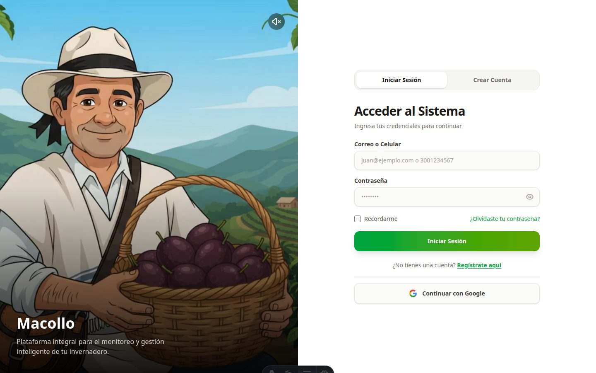
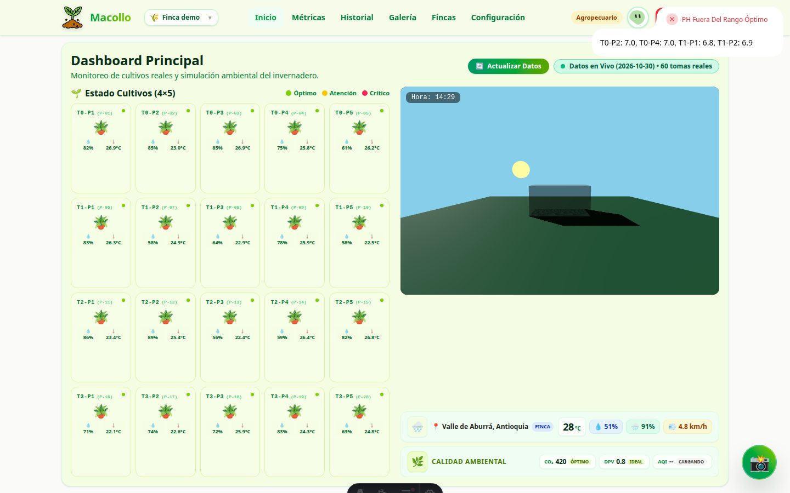
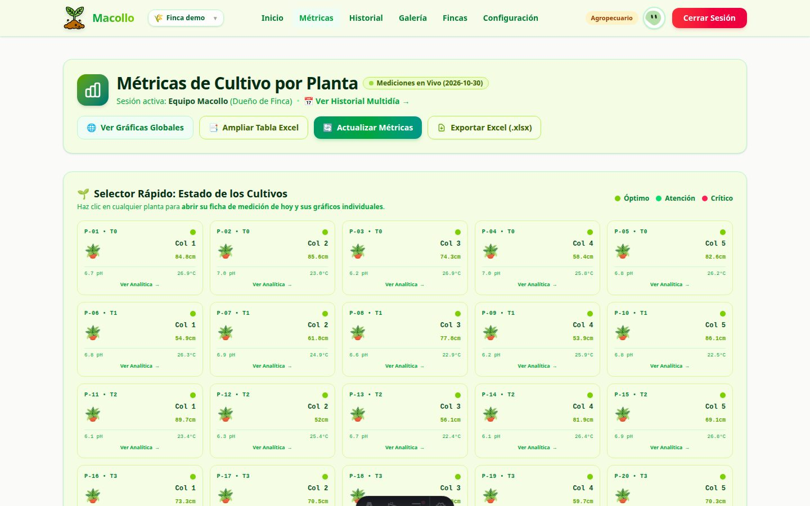
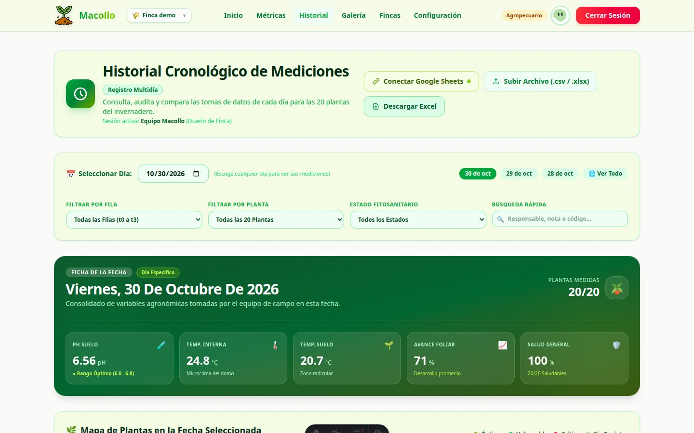
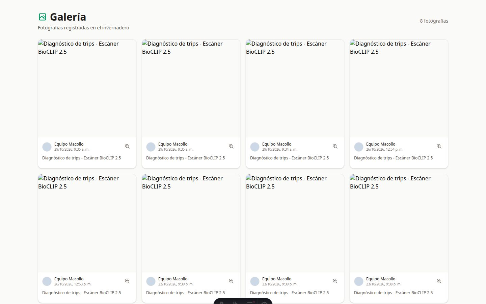
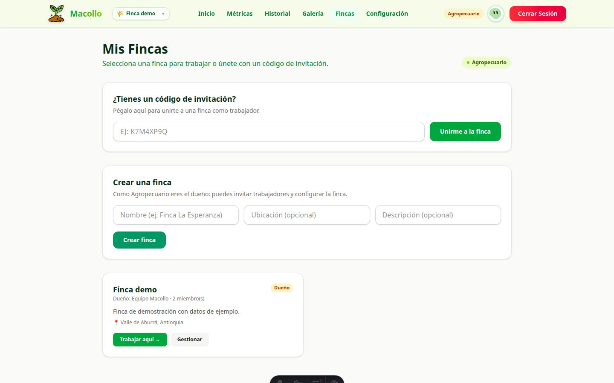
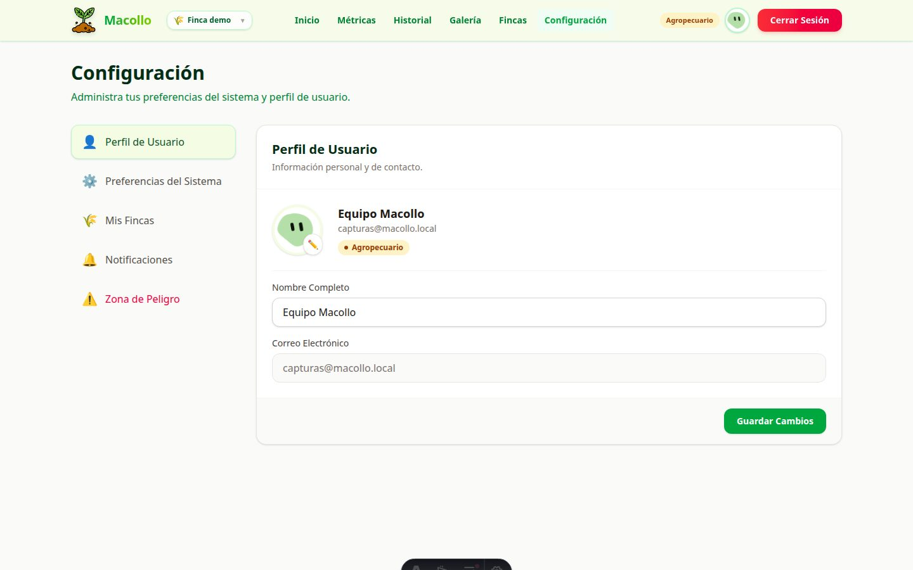
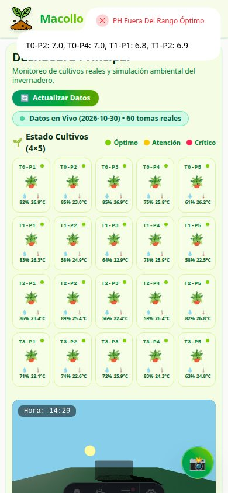

# Capturas de Pantalla Verificadas — Macollo

> Verificado contra el código el 2026-11-23. Documento rector: [docs/README.md](./README.md). Parte de la documentación unificada (`docs/UNIFIED/MACOLLO-DOCUMENTACION-UNIFICADA.md`). Identificador: **DOC-46**.

## 1. Propósito y método

Este documento incorpora al expediente unificado evidencia visual de la aplicación real. Las imágenes se obtuvieron con **Playwright** directamente contra un servidor de desarrollo en ejecución. **No se usó Astro Admin ni la ruta `/admin`**: solo se capturaron páginas de la experiencia de usuario.

- Fecha de captura: **2026-11-23**.
- Resolución escritorio: **1440 × 900 px**; móvil: **390 × 844 px**.
- Navegador: Chromium headless, `locale: es-CO`, `timezone: America/Bogota`.
- Geolocalización simulada en Medellín (6.2442, -75.5812) para evitar el aviso del navegador.
- Formato: JPEG calidad 82, suficiente para impresión en el PDF unificado.

Entorno usado:

```bash
astro dev --background
```

## 2. Inventario

| ID     | Pantalla                 | Ruta        | Archivo                                | Contenido                                                    |
| :----- | :----------------------- | :---------- | :------------------------------------- | :----------------------------------------------------------- |
| CAP-01 | Portada pública y acceso | `/`         | `docs/capturas/01-inicio-publico.jpg`  | Vista pública con pestañas de inicio de sesión y registro.   |
| CAP-02 | Dashboard principal      | `/`         | `docs/capturas/02-dashboard.jpg`       | Matriz 4×5, semáforo, clima y escena 3D con la finca activa. |
| CAP-03 | Métricas agronómicas     | `/metrics`  | `docs/capturas/03-metricas.jpg`        | Promedios, badges y tabla de métricas por planta.            |
| CAP-04 | Historial de lecturas    | `/history`  | `docs/capturas/04-historial.jpg`       | Historial por fecha con importación, Sheets y exportación.   |
| CAP-05 | Galería por finca        | `/gallery`  | `docs/capturas/05-galeria.jpg`         | Galería de fotos asociada a la finca activa.                 |
| CAP-06 | Gestión de fincas        | `/farms`    | `docs/capturas/06-fincas.jpg`          | Selección de finca activa, miembros e invitaciones.          |
| CAP-07 | Configuración            | `/settings` | `docs/capturas/07-configuracion.jpg`   | Perfil, tema y preferencias de la cuenta.                    |
| CAP-08 | Dashboard en móvil       | `/`         | `docs/capturas/08-dashboard-movil.jpg` | Vista responsive del dashboard en 390×844 px.                |

## 3. Evidencia visual

### CAP-01. Portada pública y acceso



Ruta: `/`. Vista pública con pestañas de inicio de sesión y registro.

### CAP-02. Dashboard principal



Ruta: `/`. Matriz 4×5, semáforo, clima y escena 3D con la finca activa.

### CAP-03. Métricas agronómicas



Ruta: `/metrics`. Promedios, badges y tabla de métricas por planta.

### CAP-04. Historial de lecturas



Ruta: `/history`. Historial por fecha con importación, Sheets y exportación.

### CAP-05. Galería por finca



Ruta: `/gallery`. Galería de fotos asociada a la finca activa.

### CAP-06. Gestión de fincas



Ruta: `/farms`. Selección de finca activa, miembros e invitaciones.

### CAP-07. Configuración



Ruta: `/settings`. Perfil, tema y preferencias de la cuenta.

### CAP-08. Dashboard en móvil



Ruta: `/`. Vista responsive del dashboard en 390×844 px.

## 4. Limitaciones

- Las capturas reflejan el estado del entorno local en la fecha indicada, con la base de datos de desarrollo y 60 lecturas cargadas.
- No se incluye `/admin` por instrucción explícita; las pantallas de staff se documentan en [ROUTES](./ROUTES.md) y [AUTH](./AUTH.md).
- La cámara y la inferencia ML no se disparan durante la captura: el diagnóstico se documenta en [CAMERA-ML](./CAMERA-ML.md).
- Las imágenes son artefactos derivados: no se editan manualmente.

## 5. Trazabilidad

| Tema               | Código / configuración                          | Documento relacionado                                          | Verificación                            |
| :----------------- | :---------------------------------------------- | :------------------------------------------------------------- | :-------------------------------------- |
| CAP-01…CAP-08      | Capturas con Playwright (generador no incluido) | [README](./README.md)                                          | Archivos presentes en `docs/capturas/`  |
| Rutas capturadas   | `src/pages/*.astro`                             | [ROUTES](./ROUTES.md)                                          | Coincidencia de URL y contenido visible |
| Evidencia visual   | `docs/capturas/*.jpg`                           | [PDF unificado](./UNIFIED/Macollo-Documentacion-Unificada.pdf) | Inserción de imágenes en el DOCX/PDF    |
| Exclusión de staff | Sin `/admin`                                    | [AUTH](./AUTH.md)                                              | Revisión del inventario §2              |
