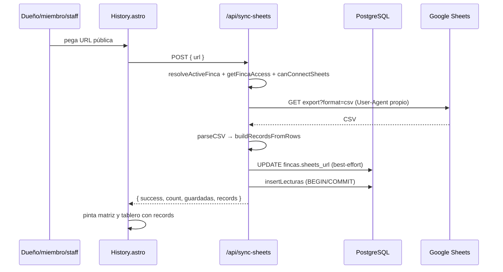
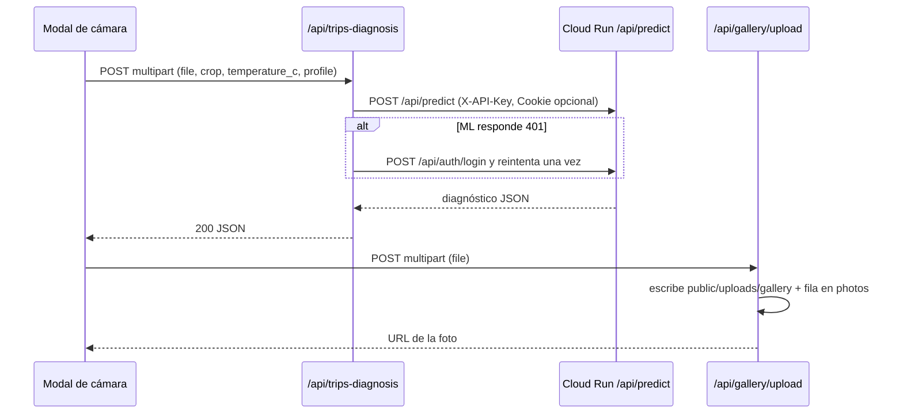
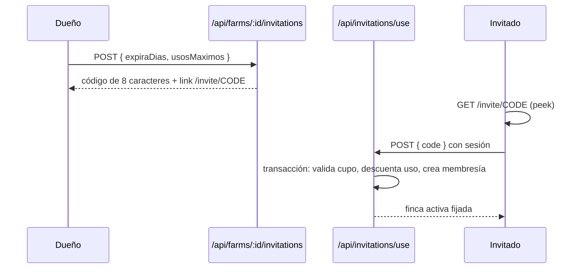

# Flujo de Datos Extremo a Extremo

> Verificado contra el código el 2026-11-23. Documento rector: [docs/README.md](./README.md). Parte de la documentación unificada (`docs/UNIFIED/MACOLLO-DOCUMENTACION-UNIFICADA.md`). Identificador: **DOC-33**.

## 1. Propósito

Este documento sigue una medición desde su origen (hoja de campo, Sheets o cámara) hasta su presentación y exportación. Es la vista complementaria de [DOMAIN-MODEL](./DOMAIN-MODEL.md) (reglas) y [INTEGRATIONS](./INTEGRATIONS.md)(sistemas externos). Cada flujo identifica el punto de validación, la transformación y el efecto persistente.

## 2. Mapa de transformaciones

| Etapa                 | Entrada                  | Transformación                                                             | Salida              | Código                                                |
| :-------------------- | :----------------------- | :------------------------------------------------------------------------- | :------------------ | :---------------------------------------------------- |
| Descarga              | URL de Sheets/Drive      | Normalización a `export?format=csv[&gid]`                                  | Texto CSV           | `src/backend/services/sheetsSync.ts:13-54`            |
| Parseo                | Texto CSV                | Delimitador automático, comillas, coma decimal                             | `string[][]`        | `src/shared/csv.ts:17-58`                             |
| Detección de cabecera | Filas                    | Búsqueda en las 10 primeras filas de `planta`+(`fecha`/`pH`/`responsable`) | Índice de cabecera  | `src/shared/recordsParser.ts:252-285`                 |
| Indexación            | Fila de cabecera         | Normalización sin tildes y synonyms                                        | `HeaderIndex`       | `src/shared/recordsParser.ts:27-246`                  |
| Resolución de planta  | `ID_planta`/fila/columna | Regex tolerante (`T0-P1`, `TO-P2`, `P-07`, `Planta 3`)                     | `PlantCoordinates`  | `src/shared/plantMatrix.ts:66-156`                    |
| Fecha                 | Celda `fecha`            | `YYYY-MM-DD`, `DD/MM/YYYY`, serial Excel, hora AM/PM                       | `{fecha, hora}`     | `src/shared/csv.ts:73-124`                            |
| Tipado y defaults     | Celdas numéricas         | Clamp, derivationes, responsable                                           | `MetricRecord`      | `src/shared/recordsParser.ts:287-405`                 |
| Persistencia          | `MetricRecord[]`         | Upsert transaccional por `(finca, planta, fecha, hora)`                    | Filas en `lecturas` | `src/backend/services/readings.ts:123-191`            |
| Agregación            | Filas de `lecturas`      | Join con `plantas`/`fincas`, `rowToRecord`                                 | `MetricRecord[]`    | `src/backend/services/readings.ts:50-104`             |
| Matriz                | `MetricRecord[]`         | 20 celdas con `latestMetric` + `history`                                   | `PlantMatrixItem[]` | `src/shared/plantMatrix.ts:190-235`                   |
| Vista                 | Matriz                   | Badges, promedios, alertas                                                 | UI + toasts         | `src/shared/badges.ts`, `alerts.ts`                   |
| Exportación           | Lecturas de la finca     | 3 hojas XLSX / CSV                                                         | Archivo binario     | `src/backend/services/excelExport.ts`, `csvExport.ts` |

## 3. Flujo A — Google Sheets a tablero



Puntos de fallo y comportamiento:

- Sin finca activa: `400 { success:false, error }` (`sync-sheets.ts:53-63`).
- Sin permiso: `403` — reciben acceso **dueño, staff y miembro** (`authz.ts:127-129`), no solo el dueño.
- HTTP externo ≠ 2xx o CSV vacío/sin registros: `422` con instrucciones de permisos (`sheetsSync.ts:66-88`).
- Falla al guardar `sheets_url`: se registra `console.warn` y la sincronización continúa (`sync-sheets.ts:102-110`).
- Falla al insertar lecturas: se registra `console.error`, pero la respuesta sigue `success:true` con `guardadas: 0` (`sync-sheets.ts:112-126`). **Es una inconsistencia conocida**: el cliente cree que importó aunque no se persistió; ver [ERROR-CATALOG](./ERROR-CATALOG.md).

## 4. Flujo B — Importación local de Excel/CSV

El navegador parsea el archivo y envía los registros a `POST /api/farms/:id/readings`, que vuelve a validar sesión y membresía antes de `insertLecturas`. La ruta acepta `{ records }` y devuelve el número de filas escritas. La exportación inversa es `GET /api/export-excel` (3 hojas) o `GET /api/export-csv`. El detalle de columnas aceptadas está en [DATA-DICTIONARY](./DATA-DICTIONARY.md) y la operación de campo en [FIELD-PROTOCOL](./FIELD-PROTOCOL.md).

```mermaid
flowchart LR
    X[XLSX/CSV local] -->|FileReader en cliente| R[MetricRecord[]]
    R -->|POST /api/farms/:id/readings| A[authz: miembro/staff]
    A --> I[insertLecturas: upsert]
    I --> P[(lecturas)]
    P --> E[export-excel / export-csv]
    P --> M[Matriz 4x5 → Dashboard/Metrics/History]
```

## 5. Flujo C — Lectura manual por API

Un integrador con sesión y acceso a la finca puede `POST /api/farms/:id/readings` con un arreglo de `records`; el servidor resuelve la planta por `(fila, columna)` contra la tabla `plantas` de esa finca. Las filas con fecha inválida o planta inexistente se omiten silenciosamente (`readings.ts:135-137`), por lo que el valor de `guardadas` puede ser menor que el tamaño del lote.

## 6. Flujo D — Clima y calidad del aire

1. El Dashboard solicita `navigator.geolocation` con timeout; si falla usa Medellín (6.2442, -75.5812).
2. `fetchWeatherData(lat, lon)` consulta Open-Meteo (temperatura, humedad, código WMO, viento y probabilidad de precipitación de la hora actual, `timezone=auto`).
3. Sin red, el cliente usa un fallback offline (22 °C, 60 %, viento 5 km/h, `source: 'Offline Fallback'`).
4. En paralelo, `GET /api/aqi?lat=&lon=` proxya WAQI.
5. El refresco es cada 10 minutos y la escena 3D ajusta sol/luna según la hora local.

> `GET /api/weather` existe como proxy SSR, pero el Dashboard actual consume Open-Meteo directamente desde el cliente (permitido por `connect-src`). SIATA queda como código latente (ADR-007). Detalle en [INTEGRATIONS](./INTEGRATIONS.md).

## 7. Flujo E — Diagnóstico de trips y galería



Notas:

- No hay reintentos artificiales con `503` para simular calentamiento; el cambio `4e977f5` los eliminó. El proxy reintenta **una sola vez** ante `401` autenticándose al panel.
- `GET /api/trips-diagnosis` verifica `/api/health` y, si `model_loaded === false`, dispara `/api/warmup` en mejor esfuerzo; responde `warming_triggered`.
- Presupuesto: 50 s totales, timeout de 45 s por intento a `/api/predict`, 25 s para health, 10 s para login y warm-up (`trips-diagnosis.ts:24-26,61,182-193`).

## 8. Flujo F — Invitación a finca



## 9. Flujo G — Resumen semanal

`POST /api/notifications/weekly-summary` relee lecturas de la finca activa, calcula promedios y conteos, y envía correo vía SMTP. Requiere que la cuenta tenga `email`; si faltan credenciales SMTP responde `502`. La preferencia `macollo-notify-weekly` y la marca `macollo-weekly-summary-last` viven en `localStorage`, por lo que el disparo depende del navegador del usuario, no de un cron del servidor (`src/shared/preferences.ts:9-11,87-89`).

## 10. Consistencia, idempotencia y observabilidad

| Propiedad                   | Mecanismo                                                                      | Limitación                                                                                     |
| :-------------------------- | :----------------------------------------------------------------------------- | :--------------------------------------------------------------------------------------------- |
| Idempotencia de importación | Upsert por `(finca, planta, fecha, hora)`                                      | `hora` vacía colisiona con cualquier lectura sin hora del mismo día                            |
| Atomicidad                  | Transacción por lote en `insertLecturas`                                       | `sheets_url` se actualiza fuera de esa transacción                                             |
| Aislamiento                 | Scope por finca en todas las consultas                                         | El panel staff puede entrar a cualquier finca por diseño                                       |
| Trazabilidad de autor       | `responsable` + `responsable_id`                                               | Si el texto está vacío se muestra `Sin registrar`                                              |
| Registro de eventos         | `console.warn/error` con prefijos `[Sync]`, `[Notificaciones]`, `[PostgreSQL]` | No hay sistema central de logs ni métricas (ver [OBSERVABILITY gaps](./OPERATIONS-RUNBOOK.md)) |

## 11. Trazabilidad

| Flujo             | Código                                             | Documento relacionado                   | Verificación                                   |
| :---------------- | :------------------------------------------------- | :-------------------------------------- | :--------------------------------------------- |
| Sheets → lecturas | `sheetsSync.ts`, `recordsParser.ts`, `readings.ts` | [ENDPOINTS](./ENDPOINTS.md)             | `curl -X POST /api/sync-sheets -d '{"url":…}'` |
| CSV → lecturas    | `src/pages/api/farms/[id]/readings.ts`             | [FIELD-PROTOCOL](./FIELD-PROTOCOL.md)   | Importar fixture de demo                       |
| Clima             | `Dashboard.astro`, `weather.ts`, `aqi.ts`          | [INTEGRATIONS](./INTEGRATIONS.md)       | Revisar `connect-src` y widget                 |
| IA y galería      | `trips-diagnosis.ts`, `gallery/upload.ts`          | [CAMERA-ML](./CAMERA-ML.md)             | `curl /api/trips-diagnosis`                    |
| Invitaciones      | `farms.ts`, `invitations/use.ts`                   | [AUTH](./AUTH.md)                       | Canjear código de demo                         |
| Exportación       | `excelExport.ts`, `csvExport.ts`                   | [DATA-DICTIONARY](./DATA-DICTIONARY.md) | Descargar y abrir `.xlsx`                      |
