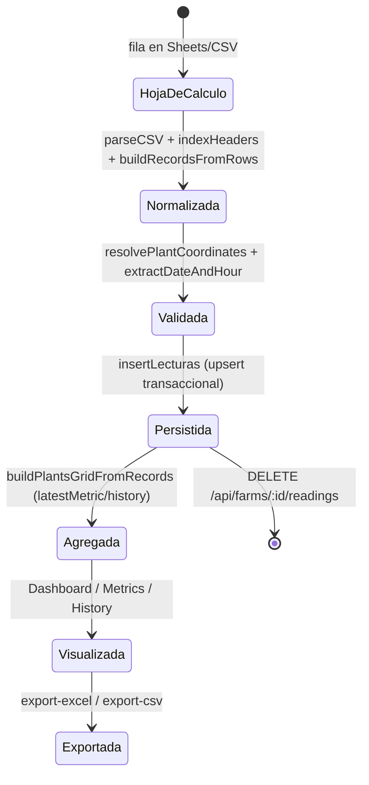

# Modelo de Dominio y Reglas de Negocio

> Verificado contra el código el 2026-11-23. Documento rector: [docs/README.md](./README.md). Parte de la documentación unificada (`docs/UNIFIED/MACOLLO-DOCUMENTACION-UNIFICADA.md`). Identificador: **DOC-32**.

## 1. Propósito

Este documento describe el **lenguaje ubicuo** y las **invariantes** del monitoreo agronómico tal como están implementadas. Complementa el diagrama ER de [DATABASE](./DATABASE.md) (estructura física) con las reglas que gobiernan el comportamiento (semántica). El contexto de sistema está en [SYSTEM-CONTEXT](./SYSTEM-CONTEXT.md).

## 2. Lenguaje ubicuo

| Término          | Definición operativa                                                                                  | Origen                                                  |
| :--------------- | :---------------------------------------------------------------------------------------------------- | :------------------------------------------------------ |
| Finca            | Aggregado raíz del tenant. Agrupa plantas, miembros, invitaciones, lecturas y fotos.                  | `fincas`                                                |
| Finca activa     | Finca seleccionada por el usuario en la cookie `finca_activa`; scope de casi toda consulta.           | `src/backend/services/authz.ts:137-160`                 |
| Planta           | Celda de la matriz 4×5 de una finca; identificada por `(fila, columna)` y por `plant_id` `P-01…P-20`. | `plantas`, `src/shared/plantMatrix.ts`                  |
| Código de planta | Notación `T{fila}-P{columna}` (p. ej. `T2-P4`). El parser tolera `TO-P2` (letra O en vez de cero).    | `src/shared/plantMatrix.ts:62-89`                       |
| Lectura          | Visita registrada a una planta en una fecha y hora; una fila en `lecturas`.                           | `src/backend/services/readings.ts`                      |
| Responsable      | Nombre de quien tomó la medición (texto) y, si se resolvió, usuario de sistema (`responsable_id`).    | `src/db/migrations/002-add-responsable-to-lecturas.sql` |
| Matriz           | Vista de 20 `PlantMatrixItem`, cada uno con `latestMetric` e `history`.                               | `src/shared/plantMatrix.ts:190-235`                     |
| Semáforo         | Clasificación visual derivada de umbrales de pH, sanidad y productividad.                             | `src/shared/badges.ts`                                  |
| Alerta           | Aviso efímero derivado de las últimas lecturas, condicionado a preferencias del usuario.              | `src/shared/alerts.ts`                                  |
| Invitación       | Código de 8 caracteres con expiración y cupos que crea una membresía.                                 | `src/backend/services/farms.ts`                         |
| Archivado        | Estado `fincas.activa = false`, reversible; distinto del _hard delete_.                               | `src/backend/services/farms.ts:189-201`                 |

## 3. Aggregados e invariantes

### 3.1 Finca

| Invariante                                                 | Implementación                                                                                                  |
| :--------------------------------------------------------- | :-------------------------------------------------------------------------------------------------------------- |
| Toda finca tiene exactamente un dueño                      | `fincas.dueno_id NOT NULL REFERENCES users` + membresía `rol_finca='dueno'` en la creación (`farms.ts:101-113`) |
| Toda finca se crea con 20 plantas                          | `seedPlantas()` inserta 4×5 con `ON CONFLICT DO NOTHING` (`farms.ts:58-76`)                                     |
| Máximo 5 fincas por dueño                                  | `MAX_FINCAS_POR_USUARIO = 5`, error `409` (`farms.ts:26,87-96`)                                                 |
| Un usuario no puede tener dos membresías en la misma finca | `UNIQUE (finca_id, user_id)`                                                                                    |
| El dueño no puede ser expulsado                            | `removeMember()` lanza `FincaError(400)` (`farms.ts:227-240`)                                                   |
| Archivar no destruye datos                                 | `setFincaActiva()` solo cambia `activa` (`farms.ts:189-197`)                                                    |

### 3.2 Planta

| Invariante                           | Implementación                                                                |
| :----------------------------------- | :---------------------------------------------------------------------------- |
| Fila ∈ {t0,t1,t2,t3}                 | `CHECK (fila IN (...))` en `plantas`                                          |
| Columna ∈ {Col 1…Col 5}              | `CHECK (columna IN (...))` en `plantas`                                       |
| No hay dos plantas en la misma celda | `UNIQUE (finca_id, fila, columna)`                                            |
| Numeración `P-01…P-20`               | `plantIdFor()` y orden fila-mayor (`src/shared/plantMatrix.ts:58-60,148-155`) |

### 3.3 Lectura

| Invariante                                          | Implementación                                                                  |
| :-------------------------------------------------- | :------------------------------------------------------------------------------ |
| Unicidad por finca, planta, fecha y hora            | `UNIQUE (finca_id, planta_id, fecha, hora)`                                     |
| Reimportar la misma medición actualiza, no duplica  | `INSERT … ON CONFLICT DO UPDATE` (`readings.ts:141-160`)                        |
| Responsable se conserva si la nueva fila no lo trae | `COALESCE(EXCLUDED.responsable, lecturas.responsable)` (`readings.ts:158-159`)  |
| Una lectura inválida se omite, no aborta el lote    | Validación `^\d{4}-\d{2}-\d{2}$` y existencia de planta (`readings.ts:135-137`) |
| Escritura atómica del lote                          | `BEGIN` / `COMMIT` / `ROLLBACK` con un `PoolClient` (`readings.ts:130-190`)     |
| Borrado de finca cascada a lecturas                 | `lecturas.finca_id … ON DELETE CASCADE`                                         |

### 3.4 Invitación

| Invariante                                           | Implementación                                                                                   |
| :--------------------------------------------------- | :----------------------------------------------------------------------------------------------- |
| Código único de 8 caracteres sin caracteres confusos | `customAlphabet(nolookalikesSafe.toUpperCase(), 8)` + reintentos (`farms.ts:28-56`)              |
| Cupos y caducidad                                    | `usos_maximos`, `usos_usados`, `expira_en`, `activa` en `finca_invitaciones`                     |
| Canje consistente                                    | Transacción con bloqueo de fila en el servicio de invitaciones (ver [ENDPOINTS](./ENDPOINTS.md)) |
| Límites de tasa                                      | `POST /api/invitations/use` a 15 intentos / 300 s por IP (`src/middleware.ts:36`)                |

## 4. Reglas de derivación agronómica

| Regla                           | Umbral / resultado                                                             | Código                                |
| :------------------------------ | :----------------------------------------------------------------------------- | :------------------------------------ |
| Badge de pH                     | 6.0–6.8 `Óptimo`; 5.5–7.2 `Atención`; resto `Crítico`                          | `src/shared/badges.ts:16-36`          |
| Badge compacto de pH            | Equivalente, con clases Tailwind adaptadas a tema oscuro                       | `src/shared/badges.ts:73-81`          |
| Sanidad                         | `Excelente` / `Saludable` → verde; `Vulnerable` → amarillo; `Crítica` → rojo   | `src/shared/badges.ts:48-71`          |
| Productividad                   | `Alta` → verde; `Media` → verde suave; `Baja` → rojo                           | `src/shared/badges.ts:38-46`          |
| pH por defecto al importar      | 6.4 si el celular no es numérico; clamp 0–14                                   | `src/shared/recordsParser.ts:318-320` |
| Humedad por defecto al importar | 65 %, clamp 0–100                                                              | `src/shared/recordsParser.ts:334-338` |
| Crecimiento derivado            | `altura ≤ 100` → altura; si no, `min(100, altura/150·100)`; sin altura → 75    | `src/shared/recordsParser.ts:343-349` |
| Sanidad derivada del pH         | `<5.2` o `>7.8` → Crítica; `<5.8` o `>7.2` → Vulnerable; `6.2–6.7` → Excelente | `src/shared/csv.ts:126-156`           |
| Fase derivada                   | Altura >80 → Llenado de Fruto; >40 → Floración; si no → Desarrollo Vegetativo  | `src/shared/recordsParser.ts:357-364` |
| Alerta crítica de pH            | pH fuera de 6.0–6.8 en la última lectura de cada planta                        | `src/shared/alerts.ts:11-12,39-58`    |
| Alerta de humedad               | Humedad < 30 % en última lectura                                               | `src/shared/alerts.ts:13,73-87`       |
| Alerta de mantenimiento         | Lectura sin pH o sin temperatura de suelo                                      | `src/shared/alerts.ts:90-106`         |
| Máximo de alertas visibles      | 3 por sesión y día (clave `macollo-alert:YYYY-MM-DD:…`)                        | `src/shared/alerts.ts:111-144`        |

## 5. Ciclo de vida de una lectura

## 6. Preferencias que afectan la presentación

| Preferencia                  | Clave                        | Valores                 | Efecto                                                    |
| :--------------------------- | :--------------------------- | :---------------------- | :-------------------------------------------------------- |
| Tema                         | `macollo-theme`              | `light`/`dark`/`system` | Clase `dark` en `<html>`                                  |
| Unidad de temperatura        | `macollo-temp-unit`          | `C`/`F`                 | Reescritura de texto en el DOM (`preferences.ts:167-226`) |
| Frecuencia de sincronización | `macollo-sync-minutes`       | 1/5/15/60 min           | Intervalo de refresco de la interfaz, **no** ingesta IoT  |
| Alertas críticas             | `macollo-notify-critical`    | 1/0                     | Activa alertas de pH, sanidad y humedad                   |
| Alertas de mantenimiento     | `macollo-notify-maintenance` | 1/0                     | Activa alerta de sensores                                 |
| Resumen semanal              | `macollo-notify-weekly`      | 1/0                     | Habilita el envío desde Settings                          |

> Todas las preferencias viven en `localStorage`; no se sincronizan entre dispositivos ni con el perfil del usuario (`src/shared/preferences.ts:22-40`).

## 7. Trazabilidad

| Regla                  | Código                                     | Documento relacionado                   | Verificación                                            |
| :--------------------- | :----------------------------------------- | :-------------------------------------- | :------------------------------------------------------ |
| Invariantes de finca   | `src/backend/services/farms.ts`            | [DATABASE](./DATABASE.md)               | Crear 6 fincas con el mismo usuario → 409               |
| Invariantes de lectura | `src/backend/services/readings.ts:123-191` | [DATA-FLOW](./DATA-FLOW.md)             | Repetir importación → `guardadas` igual, sin duplicados |
| Umbrales de semáforo   | `src/shared/badges.ts`                     | [USER_MANUAL](./USER_MANUAL.md)         | pH 6.4 → Óptimo; 7.5 → Atención                         |
| Derivación CSV         | `src/shared/csv.ts`, `recordsParser.ts`    | [DATA-DICTIONARY](./DATA-DICTIONARY.md) | Importar fixture `sample-readings-demo.csv`             |
| Alertas                | `src/shared/alerts.ts`                     | [TESTING](./TESTING.md)                 | Forzar humedad 20 % → toast crítico                     |
