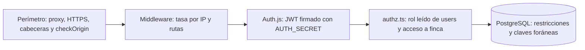

# Política de Seguridad — Macollo

> Verificado contra el código el 2026-11-23. Documento rector: docs/README.md. Parte de la documentación unificada (docs/UNIFIED/MACOLLO-DOCUMENTACION-UNIFICADA.md). Identificador: **DOC-24**.

Este documento inventaría los controles de seguridad **existentes**, las amenazas que mitigan y las brechas pendientes, con referencias de código. El detalle funcional de autenticación y autorización está en [AUTH](./AUTH.md); los conceptos de diseño en [ARCHITECTURE](./ARCHITECTURE.md) y las decisiones en `docs/decisions/`. No se describe aquí funcionalidad que no esté implementada.

## 1. Alcance y modelo de confianza

La aplicación se ejecuta en modo SSR (`output: "server"`) sobre Vercel (`astro.config.mjs:12-20`). La confianza se reparte en cuatro capas:



1. **Perímetro.** Astro declara `security.checkOrigin: true` (`astro.config.mjs:13`). El middleware interpreta `x-forwarded-proto`/`x-forwarded-host`, reescribe la URL de la petición y asigna `AUTH_URL` (`src/middleware.ts:76-96`). No añade lógica de host para la landing: `/landing` es una ruta pública más y no expone APIs ni datos de sesión.
2. **Sesión.** Auth.js usa JWT (`auth.config.ts:170-174`) con `AUTH_SECRET` obligatorio en producción (`auth.config.ts:28-37`).
3. **Autorización.** `getAuthUser()` relee `users` en cada operación sensible y `getFincaAccess()` consulta membresía activa (`src/backend/services/authz.ts:50-73`, `91-107`). Es un modelo de verificación continua dentro de la API.
4. **Persistencia.** El esquema define ENUM de roles, claves foráneas y restricciones `CHECK`/`UNIQUE` (`src/db/auth-schema.sql:13-76`, `src/db/migrations/001-roles-farms.sql:51-134`).

La frontera de confianza incluye explícitamente las cabeceras `x-forwarded-*`: se confía en que el proxy las normaliza. En ausencia de un proxy que sobrescriba esas cabeceras, un cliente puede influir en la IP del limitador y en la URL reconstruida (sección 7). `checkOrigin: true` implica que un `POST` de formulario entre dominios distintos sería `403`; por eso la landing usa exclusivamente enlaces `GET`. Si en el futuro se publica en otro dominio, las cookies de Auth.js (host-only) no compartirán sesión con la app (ver [LANDING](./LANDING.md), DOC-47).

## 2. Secretos y configuración

### 2.1. Regla y mecanismo

Ningún secreto debe versionarse: `AUTH_SECRET`, `SMTP_PASS` (o `GMAIL_APP_PASSWORD`), `GOOGLE_CLIENT_SECRET`, `DATABASE_URL`/`POSTGRES_PASSWORD` y tokens de servicios externos solo deben vivir en `.env` local no versionado o en las variables de entorno del despliegue. `.env.example:1` advierte explícitamente no commitear el `.env` real y contiene únicamente marcadores.

El hook `.husky/pre-commit:3-10` ejecuta `npx lint-staged` y rechaza el commit si algún **nombre de archivo en staging** coincide con `\.env|credentials|secret`, salvo `.env.example`. `package.json:57-59` configura `lint-staged` únicamente con `prettier --ignore-unknown --write`: **no hay escaneo de contenido**. Un secreto pegado en un archivo `.ts` versionado no es detectado por este mecanismo.

### 2.2. Variables relevantes y fallbacks reales

| Variable                                                           | Consumo en código                                 | Observación de seguridad                                                                                                                |
| :----------------------------------------------------------------- | :------------------------------------------------ | :-------------------------------------------------------------------------------------------------------------------------------------- |
| `AUTH_SECRET`                                                      | `auth.config.ts:28-37`, `175`                     | Falta en producción → excepción; en desarrollo se usa `dev-only-insecure-key-do-not-use-in-production` con advertencia                  |
| `SESSION_MAX_AGE_HOURS`                                            | `auth.config.ts:39-52`                            | Entero ≥ 1; defecto 24; expiración absoluta por `sessionStartedAt`                                                                      |
| `DATABASE_URL` o `POSTGRES_*`                                      | `src/db/client.ts:18-44`                          | Pool con `max: 20`; en producción `ssl: { rejectUnauthorized: false }` (sección 7)                                                      |
| `GOOGLE_CLIENT_ID` / `GOOGLE_CLIENT_SECRET`                        | `auth.config.ts:58-68`                            | Sin ellas el proveedor Google queda con credenciales vacías                                                                             |
| `SMTP_USER` / `SMTP_PASS`                                          | `notifications.ts:27-33`, `230-236`               | Alias `GMAIL_USER` / `GMAIL_APP_PASSWORD`; `SMTP_HOST` por defecto `smtp.gmail.com`, `SMTP_PORT` 465, `secure: port === 465` (`:53-61`) |
| `SMTP_FROM`                                                        | `notifications.ts:31-33`                          | Por defecto `"Macollo Invernadero" <no-reply@macollo.com>`                                                                              |
| `TWILIO_ACCOUNT_SID` / `TWILIO_AUTH_TOKEN` / `TWILIO_PHONE_NUMBER` | `notifications.ts:138-140`                        | Requeridas para SMS reales; **ausentes en `.env.example`**                                                                              |
| `WAQI_TOKEN`                                                       | `src/pages/api/aqi.ts:8-9`                        | Si falta, se usa un token literal embebido en el código                                                                                 |
| `ML_API_KEY`                                                       | `src/pages/api/trips-diagnosis.ts:15-19`          | Alias `API_KEY`, `ML_X_API_KEY`; si faltan, se usa una clave literal embebida                                                           |
| `ML_API_URL`                                                       | `trips-diagnosis.ts:10-13`                        | Alias `PUBLIC_API_URL`, con URL por defecto embebida                                                                                    |
| `AUTH_TRUST_HOST`                                                  | `.env.example:16`                                 | `auth.config.ts:55` fija `trustHost: true` de forma incondicional; la variable es redundante en la configuración actual                 |
| `AUTH_URL`                                                         | `.env.example:18` (comentada), `middleware.ts:94` | El middleware la sobrescribe por petición tras el proxy                                                                                 |
| `SITE`                                                             | `astro.config.mjs:12`                             | Valor por defecto `https://macollo.tech`                                                                                                |

### 2.3. Correcciones de deriva documental

- `docs/DEPLOYMENT.md:3` todavía afirma `security.checkOrigin: false`; la configuración vigente es `true` (`astro.config.mjs:13`).
- `docs/ENDPOINTS.md:121` indica `newPassword < 6`; el servidor exige **8** (`src/pages/api/auth/reset-password.ts:27-32`).
- `docs/ENDPOINTS.md:162` restringe la sincronización de Sheets al dueño; `canConnectSheets` autoriza también a `staff` y `miembro` (`src/backend/services/authz.ts:127-129`).
- `docs/ENDPOINTS.md:328` afirma que el resumen semanal imprime el código en logs; `sendWeeklySummaryEmail` no genera ni registra códigos, solo envía el correo si hay SMTP (`notifications.ts:221-243`, `287-295`).

Estos documentos no se modifican en esta revisión; se listan para evitar que su lectura invalide los controles aquí descritos.

## 3. Controles implementados

| Capa                  | Control concreto                                                                                                                   | Evidencia                                                                                          |
| :-------------------- | :--------------------------------------------------------------------------------------------------------------------------------- | :------------------------------------------------------------------------------------------------- |
| Transporte            | HSTS `max-age=31536000; includeSubDomains` cuando la petición se resuelve como HTTPS; PostgreSQL con TLS en producción             | `middleware.ts:64-74`, `src/db/client.ts:22-25`, `36-39`                                           |
| Solicitudes           | `security.checkOrigin: true` en la configuración Astro                                                                             | `astro.config.mjs:13`                                                                              |
| Navegador             | Cabeceras `X-Frame-Options`, `nosniff`, `Referrer-Policy`, `Permissions-Policy`, `COOP`, `X-DNS-Prefetch-Control`, CSP             | `middleware.ts:39-74`                                                                              |
| Rutas                 | Lista de páginas protegidas y prefijos de API; redirección con `?desde=` o `401` JSON                                              | `middleware.ts:9-27`, `129-159`                                                                    |
| Frecuencia            | Cinco reglas de ventana deslizante por IP con `Retry-After`                                                                        | `middleware.ts:30-37`, `100-127`, `rateLimit.ts:23-58`                                             |
| Sesión                | JWT firmado, `maxAge` absoluto, `sessionStartedAt`, rol por defecto `Campesino`                                                    | `auth.config.ts:39-52`, `170-207`                                                                  |
| Autorización          | Rol real reconsultado en BD; acceso a finca con `finca_miembros` y `fincas.activa = TRUE`                                          | `authz.ts:50-73`, `91-107`                                                                         |
| Multi-tenant          | `finca_id` en `plantas`/`lecturas`; cookie `finca_activa` HttpOnly contrastada contra la lista de fincas permitidas                | `001-roles-farms.sql:99-134`, `authz.ts:137-160`, `farms.ts:413-429`                               |
| Invitaciones          | Código de 8 caracteres, expiración, usos, revocación, canje con `FOR UPDATE` en transacción                                        | `farms.ts:25-31`, `43-56`, `304-369`                                                               |
| Credenciales          | bcrypt coste 10 en registro, reset y migración de hashes heredados; contraseña mínima 8                                            | `register.ts:127`, `reset-password.ts:27-32`, `49`, `auth.config.ts:115-143`                       |
| Validación de entrada | Zod en registro, disponibilidad, perfil, administración de usuarios, fincas e invitaciones; `parseJsonBody` controla JSON inválido | `register.ts:8-27`, `check-availability.ts:7-10`, `users/me.ts:14-33`, `admin/users/[id].ts:17-18` |
| Limitación de datos   | Listado administrativo con `LIMIT 200`; imagen de perfil con tope de 400.000 caracteres y patrón restringido                       | `admin/users/index.ts:21-31`, `users/me.ts:11-12`, `22-29`                                         |
| Integridad de roles   | Enum de cuatro valores; salvaguardas para el último Superadmin y para dueños de finca                                              | `001-roles-farms.sql:16-46`, `admin/users/[id].ts:48-54`, `89-105`                                 |
| Errores               | Respuestas JSON con mensajes controlados; errores de BD se-loguean en servidor y se devuelven como 500 genérico                    | `register.ts:172-178`, `forgot-password.ts:136-145`, `reset-password.ts:84-93`                     |

## 4. Cabeceras, CSP y TLS

Las cabeceras se aplican en **todas** las salidas del middleware, incluidas `429`, `401` y redirecciones (`middleware.ts:122`, `145`, `156`, `161-163`). Valores literales:

| Cabecera                     | Valor                                                            |
| :--------------------------- | :--------------------------------------------------------------- |
| `X-Frame-Options`            | `DENY`                                                           |
| `X-Content-Type-Options`     | `nosniff`                                                        |
| `Referrer-Policy`            | `strict-origin-when-cross-origin`                                |
| `Permissions-Policy`         | `camera=(self *), microphone=(), geolocation=(self), payment=()` |
| `Cross-Origin-Opener-Policy` | `same-origin`                                                    |
| `X-DNS-Prefetch-Control`     | `off`                                                            |
| `Strict-Transport-Security`  | `max-age=31536000; includeSubDomains` (condicionado a HTTPS)     |

```text
default-src 'self';
script-src 'self' 'unsafe-inline';
style-src 'self' 'unsafe-inline';
img-src 'self' data: blob: https:;
font-src 'self' data:;
connect-src 'self' https://api.open-meteo.com https://api.waqi.info;
object-src 'none';
base-uri 'self';
form-action 'self';
frame-ancestors 'none'
```

La CSP está en `src/middleware.ts:49-61`. La decisión de permitir `unsafe-inline` está documentada en el propio código (`:47-48`) por inyecciones de Astro en desarrollo y componentes inline. HSTS no incluye `preload`, no hay `Cross-Origin-Embedder-Policy` y la Directiva `connect-src` está abierta a `https:` solo para imágenes, no para scripts. La detección de HTTPS usa `request.url.startsWith("https://") || forwardedProto === "https"` (`middleware.ts:83-84`): en una petición HTTP sin cabecera de proxy, HSTS no se envía.

El pool de PostgreSQL activa TLS en producción, pero con `rejectUnauthorized: false` (`src/db/client.ts:22-25`, `36-39`), es decir, cifra sin validar el certificado del servidor: no protege frente a un atacante con capacidad de interceptación TLS.

## 5. Límite de tasa y confianza en la IP

| Endpoint                         | Peticiones | Ventana | Fuente             |
| :------------------------------- | ---------: | ------: | :----------------- |
| `/api/auth/register`             |         10 |   300 s | `middleware.ts:32` |
| `/api/auth/forgot-password`      |          8 |   300 s | `middleware.ts:33` |
| `/api/auth/reset-password`       |          8 |   300 s | `middleware.ts:34` |
| `/api/auth/callback/credentials` |         20 |   300 s | `middleware.ts:35` |
| `/api/invitations/use`           |         15 |   300 s | `middleware.ts:36` |

La ventana es deslizante: se conservan marcas de tiempo dentro de `windowSeconds` y, al alcanzar el límite, se responde `429` con `Retry-After` calculado desde la marca más antigua (`rateLimit.ts:45-57`, `middleware.ts:109-124`). El estado es un `Map` por proceso con un máximo suave de 10.000 claves y limpieza perezosa (`rateLimit.ts:5-10`, `31-37`).

La IP se toma del **primer** valor de `x-forwarded-for`, de `x-real-ip` o del literal `unknown` (`rateLimit.ts:61-65`). No se valida que esas cabeceras provengan del proxy de confianza. Tampoco hay límite para `/api/auth/check-availability`, para los demás endpoints de Auth.js ni por cuenta/identificador de recuperación.

## 6. Amenazas mitigadas

| Amenaza                                     | Control                                                                | Efecto residual                                                            |
| :------------------------------------------ | :--------------------------------------------------------------------- | :------------------------------------------------------------------------- |
| Fuerza bruta de credenciales                | 20/300 s por IP en `callback/credentials`                              | Un atacante con control de `x-forwarded-for` puede evadir el contador      |
| Creación masiva de cuentas                  | 10/300 s en `register`; unicidad de email en BD                        | El teléfono no es `UNIQUE`; la comprobación previa no es atómica           |
| Abuso de recuperación                       | 8/300 s en `forgot` y `reset`; código con TTL de 15 min                | Sin límite por identificador ni por intento de código                      |
| Robo de sesión                              | JWT firmado con `AUTH_SECRET`; cookie `finca_activa` HttpOnly          | No hay revocación server-side del JWT                                      |
| Escalada de privilegios desde el cliente    | `accountType` limitado a `Campesino`/`Agropecuario`; rol releído de BD | Las etiquetas de páginas pueden mostrar el rol antiguo del JWT             |
| Acceso cross-tenant                         | `getFincaAccess` exige membresía en finca activa; `finca_id` en datos  | Staff ve todas las fincas activas por diseño                               |
| Clickjacking / sniffing / framing externo   | `DENY`, `nosniff`, `frame-ancestors 'none'`                            | `unsafe-inline` debilita la CSP frente a XSS                               |
| Fuga del token meteorológico al cliente     | Proxy servidor en `/api/siata` con sesión obligatoria (`siata.ts:5-9`) | `/api/aqi` invoca `getSession` pero descarta el resultado (`aqi.ts:11-14`) |
| Borrado accidental del último administrador | Guardas en `PATCH`/`DELETE` de `/api/admin/users/:id`                  | No cubre cambios de rol realizados directamente en BD                      |

## 7. Riesgos conocidos y backlog

Los identificadores SEC-01 a SEC-08 se conservan de revisiones anteriores; el resto son nuevos. «Pendiente» significa que no existe control en el código citado.

| ID     | Riesgo                                               | Evidencia                                                                                     | Estado / acción propuesta                                                                                                                           |
| :----- | :--------------------------------------------------- | :-------------------------------------------------------------------------------------------- | :-------------------------------------------------------------------------------------------------------------------------------------------------- |
| SEC-01 | Handlers sensibles sin verificación de sesión        | `authz.ts:50-73`, handlers de `/api/farms`, `/api/admin`                                      | Resuelto: verificación en middleware y en cada handler                                                                                              |
| SEC-02 | Middleware con `/dashboard` como ruta muerta         | `middleware.ts:9-27`                                                                          | Resuelto: rutas reales, incluida `/gallery`, con `401`/redirect                                                                                     |
| SEC-03 | Token de calidad del aire expuesto en cliente        | `siata.ts:5-9`, `aqi.ts:8-14`                                                                 | Parcial: SIATA exige sesión; `/api/aqi` no la aplica y el token de WAQI tiene fallback embebido. Revocar la credencial expuesta y moverla a env var |
| SEC-04 | Contraseña mínima inconsistente                      | `register.ts:17-19`, `reset-password.ts:27-32`                                                | Resuelto para nuevas contraseñas: mínimo 8 en ambos                                                                                                 |
| SEC-05 | Sin límite de tasa en registro/recuperación          | `middleware.ts:30-37`                                                                         | Resuelto como línea base: ventanas deslizantes por IP en memoria                                                                                    |
| SEC-06 | Comparación de roles `'admin'` vs `'Admin'`          | `authz.ts:3`, `auth.config.ts:16`                                                             | Resuelto: enum de cuatro valores exactos                                                                                                            |
| SEC-07 | Limitador en memoria no distribuido                  | `rateLimit.ts:1-3`, `9`                                                                       | Pendiente: migrar a Redis/Upstash; las instancias no comparten contador                                                                             |
| SEC-08 | Credenciales de BD rotadas tras exposición histórica | No verificable en código                                                                      | Pendiente: rotar `POSTGRES_PASSWORD`/`DATABASE_URL` y `AUTH_SECRET` en el despliegue; confirmar que `.env` no está versionado                       |
| SEC-09 | Enumeración de cuentas                               | `forgot-password.ts:66-74`, `check-availability.ts:25-41`                                     | Pendiente: unificar respuestas y limitar `check-availability`                                                                                       |
| SEC-10 | Códigos de recuperación predecibles y reutilizables  | `forgot-password.ts:79`, `87-94`, `reset-password.ts:34-68`                                   | Pendiente: `crypto.randomInt`, hash del token, intentos máximos, consumo atómico y limpieza de expirados                                            |
| SEC-11 | Aceptación de contraseñas en texto plano             | `auth.config.ts:117-143`                                                                      | Pendiente: forzar reset de las cuentas que aún no migraron (SQL en AUTH §8)                                                                         |
| SEC-12 | JWT sin revocación y backfill de `sessionStartedAt`  | `auth.config.ts:180-207`                                                                      | Pendiente: lista de revocación o `sessions` con estrategia database si se requiere cierre inmediato                                                 |
| SEC-13 | Credenciales embebidas en código                     | `aqi.ts:8-9`, `trips-diagnosis.ts:15-19`                                                      | Pendiente, prioridad alta: retirar los literales, rotar las credenciales y fallar si falta la env var                                               |
| SEC-14 | TLS a PostgreSQL sin validación de certificado       | `src/db/client.ts:22-25`, `36-39`                                                             | Pendiente: usar `rejectUnauthorized: true` con CA confiable cuando el proveedor lo permita                                                          |
| SEC-15 | CSP permisiva y cabeceras incompletas                | `middleware.ts:39-62`                                                                         | Pendiente: eliminar `unsafe-inline` mediante hashes/nonces; revisar la lista `camera=(self *)`; valorar HSTS `preload` y COEP                       |
| SEC-16 | IP del limitador tomada de cabeceras no validadas    | `rateLimit.ts:61-65`, `middleware.ts:77-84`                                                   | Pendiente: configurar `trustHost`/proxy para sobrescribir `x-forwarded-for` y usar la IP auténtica                                                  |
| SEC-17 | Prefijos de API sin frontera de segmento             | `middleware.ts:133-135`                                                                       | Pendiente: comparar con `pathname === p \|\| pathname.startsWith(p + "/")`                                                                          |
| SEC-18 | Avatar sin verificación real de MIME/tamaño          | `users/me.ts:11-12`, `22-29`                                                                  | Pendiente: validar bytes y dimensiones en servidor; la URL remota solo se restringe a `http(s)`                                                     |
| SEC-19 | Vinculación automática de cuentas Google             | `auth.config.ts:67`                                                                           | Pendiente: valorar `allowDangerousEmailAccountLinking: false` y vinculación explícita                                                               |
| SEC-20 | Hook de secretos basado solo en nombres de archivo   | `.husky/pre-commit:7-10`, `package.json:57-59`                                                | Pendiente: añadir escaneo de contenido (gitleaks/trufflehog) en CI                                                                                  |
| SEC-21 | PII y códigos en logs de servidor                    | `auth.config.ts:90-92`, `145-147`, `register.ts:144-146`, `notifications.ts:35-49`, `142-157` | Pendiente: redactar identificadores y nunca registrar códigos de recuperación                                                                       |

## 8. Procedimientos de verificación de seguridad

```bash
BASE=http://localhost:4321

# 1. Cabeceras en una respuesta pública. En HTTP plano HSTS debe estar ausente.
curl -sSI "$BASE/" | grep -iE '^(HTTP/|content-security-policy|x-frame-options|x-content-type-options|referrer-policy|permissions-policy|cross-origin-opener-policy|x-dns-prefetch-control|strict-transport-security):'

# 2. Las mismas cabeceras deben aparecer en 401 y 429
curl -sS -D - -o /dev/null "$BASE/api/admin/users" | grep -iE '^(HTTP/|content-security-policy|x-frame-options|retry-after):'
for i in $(seq 1 9); do
  curl -sS -o /dev/null -X POST "$BASE/api/auth/forgot-password" \
    -H 'Content-Type: application/json' -d '{"identifier":"nadie@example.com"}'
done
curl -sS -D - -o /dev/null -X POST "$BASE/api/auth/forgot-password" \
  -H 'Content-Type: application/json' -d '{"identifier":"nadie@example.com"}' \
  | grep -iE '^(HTTP/|retry-after|content-security-policy):'

# 3. Enumeración: compare respuestas de un email existente y otro inexistente
curl -sS -X POST "$BASE/api/auth/check-availability" \
  -H 'Content-Type: application/json' -d '{"email":"audit-2026@example.com"}'

# 4. Roles: anónimo y Admin deben recibir 401/403 en /api/admin/users
curl -sS -o /dev/null -w 'anónimo: %{http_code}\n' "$BASE/api/admin/users"
curl -sS -o /dev/null -w 'rol no staff: %{http_code}\n' "$BASE/api/admin/users" \
  -H 'Cookie: <cookie-de-sesion-authjs>'

# 5. Revisión de secretos versionados y del hook
git ls-files | grep -E '(^|/)(\.env$|credentials|secret)' || echo 'sin .env versionado'
git check-ignore -v .env || true
```

Verificaciones en base de datos:

```sql
-- Conjunto de roles permitidos
SELECT e.enumlabel FROM pg_enum e
JOIN pg_type t ON t.oid = e.enumtypid
WHERE t.typname = 'user_role_enum' ORDER BY e.enumsortorder;

-- Contraseñas pendientes de migrar a bcrypt (objetivo: 0 filas)
SELECT count(*) AS pendientes FROM users
WHERE password IS NOT NULL AND password !~ '^\$2[aby]\$';

-- Códigos de recuperación en texto plano y su antigüedad
SELECT identifier, expires, expires - NOW() AS restante
FROM verification_token ORDER BY expires DESC LIMIT 20;

-- Superadmins: nunca debe quedar menos de uno por operación desde /admin
SELECT id, email, role FROM users WHERE role = 'Superadmin';

-- Teléfonos duplicados: la unicidad solo se comprueba en la aplicación
SELECT phone, count(*) FROM users WHERE phone IS NOT NULL
GROUP BY 1 HAVING count(*) > 1;

-- Dueños con fincas asociadas: bloquean el DELETE desde el panel
SELECT dueno_id, count(*) AS fincas FROM fincas GROUP BY dueno_id ORDER BY 2 DESC;
```

Revisión de configuración del despliegue: confirmar en el panel de Vercel que `AUTH_SECRET`, `DATABASE_URL` y `SMTP_PASS` están definidos, que no aparecen literales de token en `src/pages/api/aqi.ts:9` ni en `src/pages/api/trips-diagnosis.ts:19`, y que `astro.config.mjs:13` mantiene `checkOrigin: true`.

## 9. Reporte de vulnerabilidades

Canal: issue privado al equipo de mantenimiento o correo del administrador del sistema; no abrir un issue público con detalles explotables. Incluir ruta y método, rol necesario, pasos de reproducción, impacto, evidencia (respuesta o log redactado) y una prueba de concepto mínima. Para incidencias críticas se mantiene como objetivo una corrección en 72 horas y su registro en [CHANGELOG](./CHANGELOG.md). Antes de divulgar, verificar si el hallazgo corresponde a SEC-01…SEC-21 para no duplicar esfuerzos.

## Trazabilidad

| Tema                          | Archivo(s) de código                                                                              | Doc(s) relacionado(s)                        | Verificación sugerida                                                 |
| :---------------------------- | :------------------------------------------------------------------------------------------------ | :------------------------------------------- | :-------------------------------------------------------------------- |
| Secretos y hook               | `.env.example`, `.husky/pre-commit`, `package.json`, `src/db/client.ts`                           | `docs/DEPLOYMENT.md`, `docs/CONTRIBUTING.md` | `git ls-files` y `git check-ignore`; inspeccionar variables en Vercel |
| Cabeceras, CSP y HSTS         | `src/middleware.ts`                                                                               | `docs/AUTH.md`, `docs/ARCHITECTURE.md`       | `curl -I` sobre `/`, un `401` y un `429`                              |
| TLS y base de datos           | `src/db/client.ts`                                                                                | `docs/DATABASE.md`, `docs/DEPLOYMENT.md`     | Revisar `ssl.rejectUnauthorized` y certificado del proveedor          |
| Sesión y roles                | `auth.config.ts`, `src/backend/services/authz.ts`                                                 | `docs/AUTH.md`, `docs/UML.md`                | `GET /api/auth/session`; consulta de `pg_enum`                        |
| Limitación de tasa            | `src/middleware.ts`, `src/backend/services/rateLimit.ts`                                          | `docs/AUTH.md`, `docs/ENDPOINTS.md`          | Ráfaga de peticiones y comprobación de `Retry-After`                  |
| Recuperación y notificaciones | `src/pages/api/auth/{forgot-password,reset-password}.ts`, `src/backend/services/notifications.ts` | `docs/AUTH.md`, `docs/TROUBLESHOOTING.md`    | Simular sin SMTP y revisar `verification_token` en SQL                |
| Multi-tenant e invitaciones   | `src/backend/services/{authz,farms}.ts`, `src/db/migrations/001-roles-farms.sql`                  | `docs/AUTH.md`, `docs/DATABASE.md`           | Intentar acceso a otra finca; verificar `FOR UPDATE` y `usos_usados`  |
| Credenciales embebidas        | `src/pages/api/aqi.ts`, `src/pages/api/trips-diagnosis.ts`                                        | `docs/CAMERA-ML.md`, `docs/ENDPOINTS.md`     | Buscar literales `token=`/`X-API-Key` y rotar credenciales            |
| Perfil y entrada de datos     | `src/pages/api/users/me.ts`, `src/backend/services/profile.ts`                                    | `docs/AUTH.md`, `docs/ENDPOINTS.md`          | `PATCH` con imagen inválida y con `role` incluido                     |
| Backlog SEC-01…SEC-21         | Todo el código citado en las tablas anteriores                                                    | `docs/ROADMAP.md`, `docs/CHANGELOG.md`       | Revisión trimestral del estado de cada ID                             |
