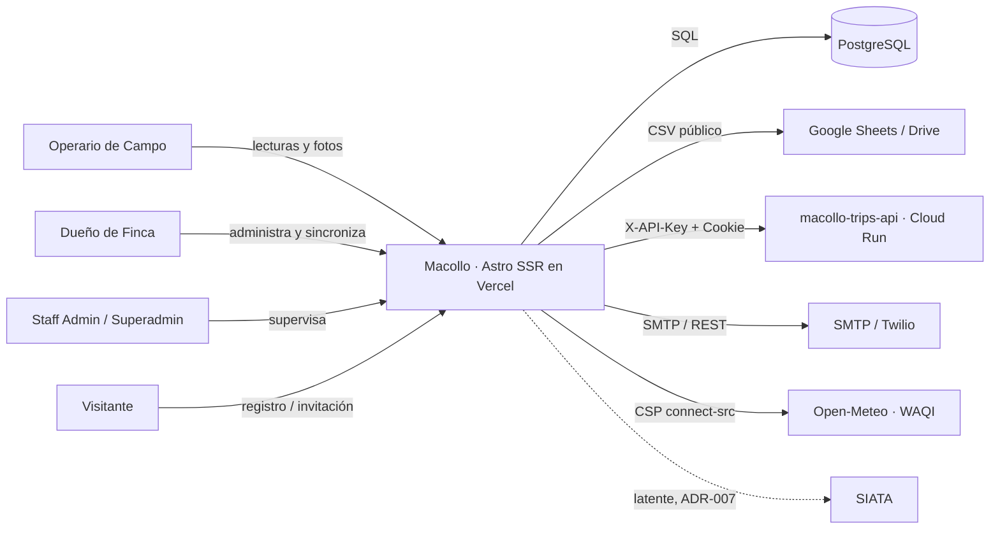

# Contexto y Fronteras del Sistema

> Verificado contra el código el 2026-11-23. Documento rector: [docs/README.md](./README.md). Parte de la documentación unificada (`docs/UNIFIED/MACOLLO-DOCUMENTACION-UNIFICADA.md`). Identificador: **DOC-31**.

## 1. Propósito y posición en el conjunto

Este documento fija **qué está dentro** de Macollo y **qué queda fuera**, quién interactúa con el sistema y con qué sistemas externos se comunica. Es el punto de partida de la especificación: los requisitos ([REQUIREMENTS](./REQUIREMENTS.md)), los casos de uso ([USE_CASES](./USE_CASES.md)) y el modelo de dominio ([DOMAIN-MODEL](./DOMAIN-MODEL.md)) se leen después de este documento.

## 2. Actores

| Actor                              | Tipo    | Interacción principal                             | Punto de entrada                        |
| :--------------------------------- | :------ | :------------------------------------------------ | :-------------------------------------- |
| Visitante                          | Humano  | Registro, acceso, vista previa de invitación      | `/`, `/invite/[code]`                   |
| Operario de Campo (`Campesino`)    | Humano  | Toma y consulta de lecturas; usa cámara           | `/`, `/metrics`, `/history`, `/gallery` |
| Dueño de Finca (`Agropecuario`)    | Humano  | Administra su finca, invita, sincroniza y exporta | `/farms`, `/farms/[id]`, `/history`     |
| Administrador de Cultivo (`Admin`) | Humano  | Supervisa todas las fincas y entra a ellas        | `/admin`                                |
| Superadministrador (`Superadmin`)  | Humano  | Gestiona usuarios, roles y borrado físico         | `/admin`                                |
| Servicio ML                        | Sistema | Recibe imágenes, devuelve diagnóstico             | `${ML_API_URL}/api/predict`             |
| Proveedor de correo/SMS            | Sistema | Entrega códigos y resúmenes                       | SMTP / Twilio REST                      |
| Hojas de cálculo                   | Sistema | Fuente de datos agronómicos                       | Google Sheets/Drive → CSV               |

## 3. Diagrama de contexto

## 4. Frontera de responsabilidades

| Responsabilidad                                |   Dentro de Macollo   |       Fuera de Macollo        |
| :--------------------------------------------- | :-------------------: | :---------------------------: |
| Renderizar la matriz 4×5 y los semáforos       |          Sí           |               —               |
| Persistir lecturas y membresías                |          Sí           |               —               |
| Validar permisos por finca                     |          Sí           |               —               |
| Normalizar CSV y derivar sanidad/productividad |          Sí           |               —               |
| Emitir JWT y verificar sesión                  |          Sí           |               —               |
| Ejecutar inferencia BioCLIP                    |          No           |      `macollo-trips-api`      |
| Entrenar o reindexar el modelo                 |          No           |      `macollo-trips-api`      |
| Almacenar archivos de imagen                   | Sí (filesystem local) |               —               |
| Enviar correo/SMS                              |   Orquesta el envío   |          SMTP/Twilio          |
| Proveer clima y AQI                            | Proxy y presentación  |        Open-Meteo/WAQI        |
| Gestionar DNS/TLS del sitio                    |          No           | Vercel / proveedor de dominio |

> Nota: el guardado de fotos usa `public/uploads/gallery/` (`src/pages/api/gallery/upload.ts`). En serverless, ese directorio no es persistente entre despliegues; es una limitación operativa documentada en [OPERATIONS-RUNBOOK](./OPERATIONS-RUNBOOK.md).

## 5. Fronteras de confianza

| Frontera                  | Mecanismo                                                    | Verificación                                                       |
| :------------------------ | :----------------------------------------------------------- | :----------------------------------------------------------------- |
| Navegador → Vercel        | `security.checkOrigin: true`, CSP, `same-origin`, rate limit | `astro.config.mjs:13`, `src/middleware.ts:39-62,100-127`           |
| Petición → sesión         | `getSession` en middleware y `getAuthUser` en handlers       | `src/middleware.ts:137-159`, `src/backend/services/authz.ts:50-73` |
| Sesión → rol              | Rol releído de PostgreSQL en cada handler                    | `src/backend/services/authz.ts:59-72`                              |
| Usuario → finca           | `getFincaAccess` + cookie `httpOnly`                         | `src/backend/services/authz.ts:91-107,137-147`                     |
| Servidor → Sheets         | URL pública, sin credenciales de Google                      | `src/backend/services/sheetsSync.ts:56-89`                         |
| Servidor → ML             | `X-API-Key` + cookie de panel, solo servidor                 | `src/pages/api/trips-diagnosis.ts:79-88`                           |
| Cliente → Open-Meteo/WAQI | Domains fijos en `connect-src`                               | `src/middleware.ts:56`                                             |

## 6. Supuestos y dependencias

1. PostgreSQL accesible desde Vercel con SSL; `DATABASE_URL` tiene prioridad sobre las variables `POSTGRES_*` (`src/db/client.ts:19-43`).
2. La finca activa se conserva en una cookie con 30 días de validez y `SameSite=Lax` (`src/backend/services/authz.ts:140-143`).
3. Google Sheets debe estar públicamente legible; no se usa OAuth de Google para Sheets.
4. El modelo de ML puede arrancar en frío; el proxy tiene un presupuesto de 50 s y `maxDuration=60` (`trips-diagnosis.ts:7,24-26`).
5. La geolocalización del navegador es opcional; si falla se usa Medellín comoreferencia (ver [INTEGRATIONS](./INTEGRATIONS.md)).
6. Las reglas agronómicas son umbrales fijos del código, no un modelo calibrado por finca.

## 7. Fuera de alcance

- Control de riego o actuadores IoT: la frecuencia de sincronización de Settings es una preferencia de interfaz, no ingesta automática (`src/shared/preferences.ts:91-100`).
- Facturación, inventario o trazabilidad de exportación comercial.
- Aplicación móvil nativa: el acceso es responsive y usa cámara nativa vía `input[capture]` cuando no hay HTTPS.
- Historial inmutable: `DELETE /api/farms/:id/readings` permite borrar todo el historial de una finca (documentado en [ENDPOINTS](./ENDPOINTS.md)).

## 8. Trazabilidad

| Elemento del contexto | Código / configuración                           | Documento relacionado             | Verificación                       |
| :-------------------- | :----------------------------------------------- | :-------------------------------- | :--------------------------------- |
| Frontera HTTP         | `astro.config.mjs`, `src/middleware.ts`          | [ROUTES](./ROUTES.md)             | `curl -I https://macollo.tech`     |
| Actores y roles       | `src/shared/roles.ts`, `auth.config.ts`          | [AUTH](./AUTH.md)                 | Panel `/admin`                     |
| Servicio ML           | `src/pages/api/trips-diagnosis.ts`               | [CAMERA-ML](./CAMERA-ML.md)       | `GET /api/trips-diagnosis`         |
| Fuentes externas      | `src/pages/api/weather.ts`, `aqi.ts`, `siata.ts` | [INTEGRATIONS](./INTEGRATIONS.md) | Verificar `connect-src` en headers |
| Persistencia          | `src/db/client.ts`, `src/db/*.sql`               | [DATABASE](./DATABASE.md)         | `\dt` en psql                      |
